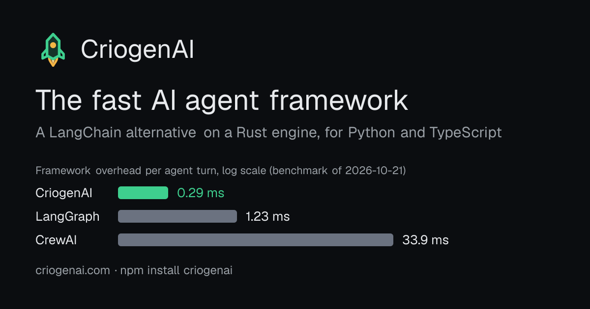

<div align="center">

<a href="https://criogenai.com"></a>

### Build AI agents in Python or TypeScript. Run them on a Rust engine.

Tools, human approval, conversations that survive crashes, memory, an audit trail<br>
and one gateway for every model provider. Open source.

[](https://pypi.org/project/criogenai/)
[](https://www.npmjs.com/package/criogenai)
[](https://pypi.org/project/criogenai/)
[](https://www.npmjs.com/package/criogenai)
[](#license)
[](https://github.com/VARMAMASTER/criogenai/stargazers)

[**Website**](https://criogenai.com) ·
[**Quickstart**](https://criogenai.com/docs/quickstart/) ·
[**Docs**](https://criogenai.com/docs/) ·
[**Playground**](https://criogenai.com/playground/) ·
[**Benchmarks**](https://criogenai.com/benchmarks/) ·
[**Discussions**](https://github.com/VARMAMASTER/criogenai/discussions)

</div>

---

```sh
pip install criogenai      # Python 3.9+
npm install criogenai      # Node.js 18+, also in the browser as "criogenai/web"
```

Prebuilt for **Windows** x64, **Linux** x64 and ARM64, and **macOS** Apple Silicon and Intel. No Rust
toolchain needed.

## ✨ Why CriogenAI

- ⚡ **Low overhead.** The agent loop, tool scheduling, validation and saving run in Rust:
  **0.29 ms** of framework overhead per agent turn, and **1,000 concurrent agent runs in 0.42 s**.
- 💾 **Runs that survive crashes.** Every step and every tool call is saved (SQLite or Postgres).
  After a crash, the run continues where it stopped, without running finished tools again.
- ✋ **Human approval built in.** Mark the risky tools. The run stops before them and waits in the
  database until someone approves, edits or rejects the call, from any process.
- 🔒 **Ready for regulated work.** Encryption at rest, a hash-chained audit trail without message
  content, retention rules and redaction before anything reaches a provider.
- 🌐 **One engine, three languages.** Python, TypeScript and Rust share the same engine, error codes
  and saved formats, so a conversation started in Python can continue in TypeScript.

## 🚀 A first agent

```python
import asyncio
from criogenai import Agent, ToolError, tool


@tool
async def get_order(order_id: str) -> dict:
    """Look up an order by id."""
    if order_id != "A-1001":
        raise ToolError(f"No order {order_id}")  # the model sees this and can recover
    return {"status": "shipped", "eta": "tomorrow"}


agent = Agent(
    "openai:gpt-5-mini",  # key from OPENAI_API_KEY
    instructions="You are a support agent. Be brief.",
    tools=[get_order],
)


async def main() -> None:
    result = await agent.run("Where is order A-1001?")
    print(result.text)


asyncio.run(main())
```

<details>
<summary><b>The same agent in TypeScript</b></summary>

```ts
import { Agent, ToolError, tool } from "criogenai";

const getOrder = tool({
  name: "get_order",
  description: "Look up an order by id.",
  input: { type: "object", properties: { orderId: { type: "string" } }, required: ["orderId"] },
  run: async ({ orderId }) => {
    if (orderId !== "A-1001") throw new ToolError(`No order ${orderId}`);
    return { status: "shipped", eta: "tomorrow" };
  },
});

const agent = new Agent({
  model: "openai:gpt-5-mini",
  instructions: "You are a support agent. Be brief.",
  tools: [getOrder],
});
console.log((await agent.run("Where is order A-1001?")).text);
```

</details>

Next: the [tutorial](https://criogenai.com/docs/tutorial/support-agent/) builds a complete support
agent with approval, a saved conversation and memory, step by step. Or try
[19 agent patterns in your browser](https://criogenai.com/playground/), running on the real engine
compiled to WebAssembly, no install and no key needed.

## 📊 Benchmarks

The same work and the same simulated model in every framework, so only the framework is timed
(one machine, Python 3.13, 2026-10-21):

| | **CriogenAI** | LangGraph | CrewAI |
|---|:---:|:---:|:---:|
| Framework overhead per agent turn | **0.29 ms** | 1.23 ms | 33.9 ms |
| 1,000 agent runs at once (whole batch) | **0.42 s** | 4.95 s | 78.2 s |
| Reliability tests passed by default | **5 of 5** | 2 of 5 | 4 of 5 |
| Packages installed | **1** | 42 | 138 |
| Install size | **17.9 MB** | 42.9 MB | 742.7 MB |
| Time to import | **148 ms** | 1.70 s | 9.30 s |

With one agent and a real model, the model's own time dominates; the difference shows with many
steps, many tool calls and many users at once. Every scenario, the exact versions, the raw JSON and a
kit to rerun it on your machine: [criogenai.com/benchmarks](https://criogenai.com/benchmarks/).

## 🧰 What's inside

| | |
|---|---|
| 🤖 **Agents and tools** | Functions become tools; arguments are checked against a schema before your code runs. A turn's tool calls run at the same time, with timeouts, limits and retries. |
| 🔀 **Workflows** | Graphs of steps and agents: routes, parallel branches, joins, loops and pauses for a person, plus ready-made multi-agent patterns. |
| 🧠 **Memory and search** | Long-term memory per user, and document collections searched by meaning, usable as agent tools. |
| 🔌 **Every model provider** | OpenAI (Responses API), Anthropic, Gemini, Azure OpenAI, Amazon Bedrock, Google Vertex AI, OpenRouter, DeepSeek, Mistral, xAI, Groq and more by name; Ollama, LM Studio, vLLM or any compatible server for self-hosted models. Retries and fallbacks between models. |
| 🧩 **MCP tools** | Use tools from any MCP server, over HTTP or a local process. |
| ✅ **Evals** | Datasets, scorers and LLM judges that fail CI when quality drops. |
| 🔭 **Tracing** | To Langfuse, OpenTelemetry or a local trace viewer. |
| 🚪 **LLM gateway** | One OpenAI- and Anthropic-compatible endpoint for every model, with virtual keys, rate limits and budgets. |

What is built and what is planned, per language: [status](https://criogenai.com/docs/status/).
Coming from LangGraph? The [migration guide](https://criogenai.com/docs/from-langgraph/) maps every
concept.

## 🦀 Rust

The engine is Rust, and the crates are usable directly. They are not on crates.io yet, so depend on
this repository:

```toml
[dependencies]
criogenai-agent = { git = "https://github.com/VARMAMASTER/criogenai", features = ["sqlite"] }
criogenai-providers = { git = "https://github.com/VARMAMASTER/criogenai" }
criogenai-storage = { git = "https://github.com/VARMAMASTER/criogenai", features = ["sqlite"] }
```

Reference: [Rust API](https://criogenai.com/docs/reference/api/rust/).

## 📍 Status

Early development: 0.1, and the API may change between 0.x releases. Changes are listed in the
[changelog](CHANGELOG.md).

<details>
<summary><b>Repository layout</b></summary>

```
crates/criogenai-core/        the workflow engine (steps, routes, pauses, retries)
crates/criogenai-providers/   messages, tools, model protocols and providers
crates/criogenai-agent/       agents: the model and tools loop, threads, MCP, evals
crates/criogenai-storage/     threads, checkpoints, SQLite and Postgres, memory, audit
crates/criogenai-telemetry/   OpenTelemetry and Langfuse export
crates/criogenai-gateway/     the LLM gateway (library and binary)
crates/criogenai-trace/       the local trace viewer
crates/criogenai-rt/          tasks and timers on servers and in the browser
crates/criogenai-js/          the bridge under the Node.js addon and the WebAssembly build
sdks/python/                  the Python package (PyO3, maturin)
sdks/typescript/              the TypeScript package (napi-rs, WebAssembly)
website/                      criogenai.com: docs, API reference, benchmarks, playground
docs/                         architecture, design decisions, research notes
```

</details>

<details>
<summary><b>Building and testing</b></summary>

Requires Rust 1.88+, Python 3.9+ and Node.js 18+.

```sh
cargo test --workspace --all-features   # the Rust crates
bash scripts/test-python.sh             # builds the wheel, installs it in a new venv, runs pytest
bash scripts/test-typescript.sh         # builds the npm package, installs it in a new project, runs the tests
bash scripts/ci-local.sh                # the whole pipeline (CI runs locally for now)
```

Tests never call a real model: they use a simulated one. How the system works:
[docs/architecture.md](docs/architecture.md). Notes for contributors and AI assistants:
[AGENTS.md](AGENTS.md).

</details>

## 🤝 Community and contributing

- 💬 Questions and ideas: [GitHub Discussions](https://github.com/VARMAMASTER/criogenai/discussions)
- 🐛 Bugs and feature requests: [issues](https://github.com/VARMAMASTER/criogenai/issues)
- 🛠️ Pull requests are welcome; see [CONTRIBUTING.md](CONTRIBUTING.md)
- 🔐 Report security problems privately as described in [SECURITY.md](SECURITY.md)

If CriogenAI is useful to you, a ⭐ helps other people find it.

## License

Licensed under either of [Apache License, Version 2.0](LICENSE-APACHE) or
[MIT license](LICENSE-MIT), at your option.

Unless you explicitly state otherwise, any contribution intentionally submitted
for inclusion in this project by you, as defined in the Apache-2.0 license,
shall be dual licensed as above, without any additional terms or conditions.
