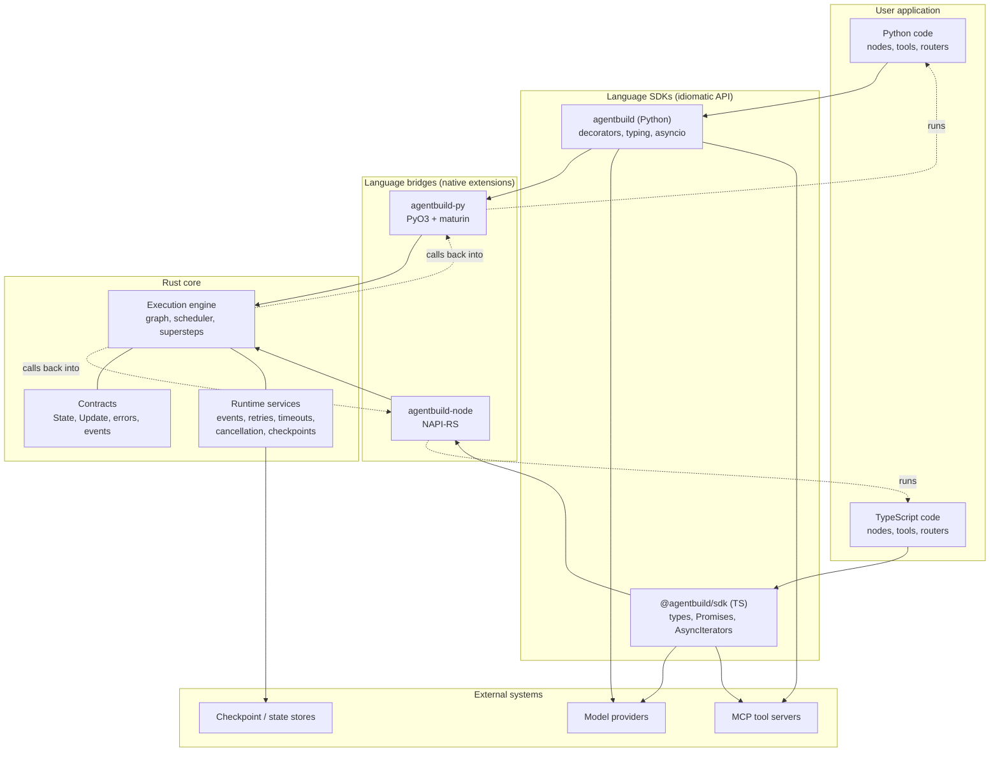
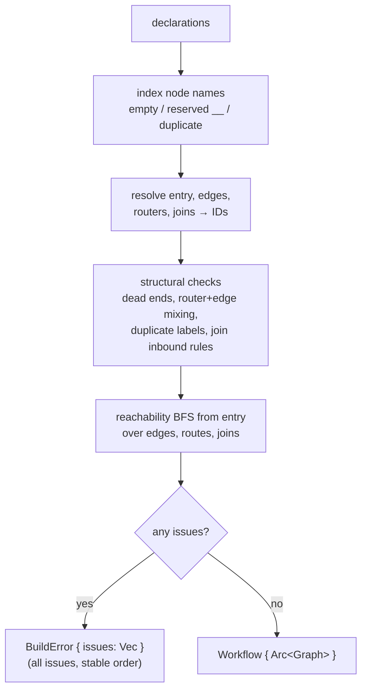
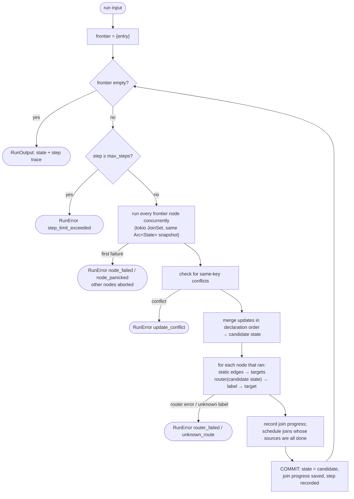
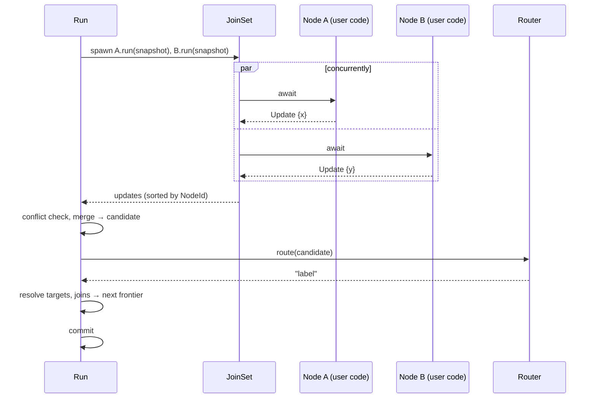
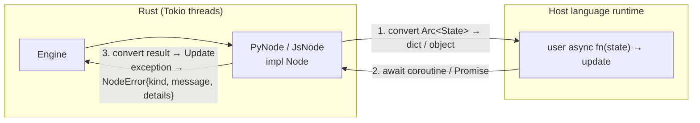
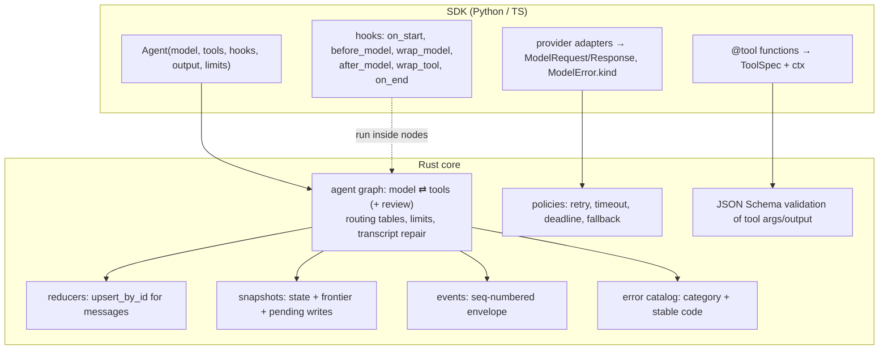

# AgentBuild architecture

How the system is put together and how it works. Each section is marked:

- **Implemented**: exists in this repository and is tested.
- **Proposed**: the intended design. Not built; open to change during the design phase.

Execution semantics live in [design/0001-execution-model.md](design/0001-execution-model.md).
Research on LangChain and LangGraph lives in [research/](research/). Agent, tool and error design: §7.

---

## 1. System overview (proposed)

Developers write agents and workflows in Python or TypeScript. One Rust runtime
schedules and executes them. User functions always run in their own language's
interpreter; the runtime coordinates and calls them.



Model-provider calls are **decided** to live in a shared Rust provider layer
(`agentbuild-providers`, [0006](design/0006-provider-layer.md); §8 item 1), not
in each SDK. The diagram above predates that decision for the SDK boxes.

### Products and how people use them (proposed)

AgentBuild's primary purpose is letting developers **build agents and
workflows** in Python and TypeScript (developer API: [0007](design/0007-public-api.md)).
It is two products on one Rust foundation: a **fast agent engine**
(`agentbuild-core` plus the agent layer) and a **fast LLM gateway**
(`agentbuild-providers`). The gateway is designed to be **embedded in other
people's projects**, so it is a library first and a server second.

| Mode | Who it's for | Shape |
|---|---|---|
| 1. Library, Rust | Rust services | `agentbuild-providers` crate: `gateway.chat(request).await`, streaming, errors per 0003 |
| 2. Library, Python / TS | Python and Node apps, with or without agents | `from agentbuild.gateway import Gateway` / `import { Gateway } from "@agentbuild/sdk"`; in-process, no server |
| 3. Mounted in the user's server | Apps that want a gateway endpoint inside their own service | Rust `axum::Router`, Python ASGI app, JS fetch handler `(Request) => Response` (works with Hono, Next.js route handlers, Express adapters) |
| 4. Standalone | Teams replacing a proxy | One static binary and a Docker image; OpenAI-compatible `/v1/chat/completions`, `/v1/models` and Anthropic-compatible `/v1/messages`; official OpenAI/Anthropic SDKs work by changing `base_url` |

**Embedding requirements** (non-negotiable for modes 1–3):

- **No required infrastructure.** Stateless by default: no database, Redis or
  queue. API keys, budgets, request logs and caching are optional plugins.
- **No global state.** Several independently configured gateways can live in
  one process. Configuration is in code; a config file is only for mode 4.
- **Small footprint.** Each provider protocol is a Cargo feature; users compile
  only what they use. No AWS/Azure/GCP SDKs unless the matching feature is on.
- **Host-friendly.** Runs on the host's event loop (asyncio / Node) through the
  bridges; accepts a caller-supplied HTTP client, proxy and TLS settings.
- **No telemetry phoning home.** Observability goes through the event stream
  (0005 §6) and exporters the user chooses.
- **Secrets never logged** (0003 §6.4).
- **Stable API** under semver, with OpenAI/Anthropic compatibility tested
  against the official SDKs.
- **Permissive license:** MIT OR Apache-2.0, so it can be used in commercial
  and closed-source projects.

### Layer rules

Dependencies point inward: SDK → bridge → core. Never the reverse.

| Layer | Owns | Must not contain |
|---|---|---|
| Core contracts | Data types that cross every boundary | Language-specific code, I/O |
| Execution engine | Graph model, validation, scheduling, merging | Provider SDKs, Python/JS types |
| Runtime services | Events, policies, persistence interfaces | Concrete vendor code (behind traits) |
| Bridges | Converting values and errors; owning the async runtime; calling user code | Business logic, scheduling decisions |
| SDKs | Idiomatic APIs, typing, docs, ergonomics | Re-implementations of engine semantics |

The engine defines behaviour once. SDKs must not reimplement scheduling, merging
or validation, or Python and TypeScript will drift apart.

---

## 2. Rust core: module map (implemented)

Crate: `crates/agentbuild-core`. Dependencies: `tokio` (rt), `serde`,
`serde_json`, `thiserror`.

```mermaid
flowchart LR
    lib["lib.rs<br/>public API + END"]
    state["state.rs<br/>State, Update"]
    reducer["reducer.rs<br/>Reducer, merge"]
    event["event.rs<br/>Event, channel, Hub"]
    node["node.rs<br/>Node, Router traits<br/>node_fn, router_fn"]
    graph["graph.rs<br/>WorkflowBuilder → validate → Workflow<br/>internal Graph"]
    runtime["runtime.rs<br/>Run: superstep loop<br/>RunOptions, RunOutput"]
    error["error.rs<br/>NodeError, ValidationIssue,<br/>BuildError, RunError(Kind)"]

    lib --> graph & runtime & state & node & error & reducer & event
    runtime --> reducer & event
    graph --> node & error
    runtime --> graph & state & error
    node --> state & error
    state --> error
```

| Type | Role |
|---|---|
| `State` | JSON object shared by a run. Nodes read an `Arc<State>` snapshot. |
| `Update` | Partial JSON object a node returns. Each key replaces the stored value. |
| `Node` | Object-safe trait: `run(NodeContext, Arc<State>) -> BoxFuture<Result<NodeOutput, NodeError>>`. **The language-bridge seam.** |
| `NodeContext` / `NodeOutput` | Run info passed to nodes; `Update` / `Command{goto}` / `Suspend{payload}` |
| `Reducer` | Per-key merge rule: `Replace`, `Append`, `UpsertById` |
| `Snapshot` / `RunStatus` | Suspended run as JSON; `Completed` or `Suspended{interrupts, snapshot}` |
| `Event` / `EventKind` | Lifecycle and custom events with `seq`, scope and `ts_ms` (0005 §6) |
| `event_channel` / `RunStream` | Subscribe to one run's events; `Workflow::stream` spawns the run and yields events |
| `Router` | Object-safe trait: `route(Arc<State>) -> BoxFuture<Result<String, NodeError>>`. Returns a label. |
| `WorkflowBuilder` | Records nodes, entry, edges, routers and joins. `build()` validates and reports every issue at once. |
| `Workflow` | Immutable compiled graph behind an `Arc`. Cheap to clone; safe for concurrent runs. |
| `Graph` (internal) | Nodes indexed by `usize` (declaration order); per-node outgoing transitions; join tables. |
| `Run` (internal) | One run's mutable state: committed `State` and join progress. |
| `RunError` | `kind` (stable `code()`), failing `step`, last committed `state`. |

### Compiled graph representation

Names are resolved to integer IDs once, at build time. The run loop never
hashes strings for scheduling.

```
names:       ["normalize", "summarize", "echo"]     index = NodeId
nodes:       [Arc<dyn Node>; n]
entry:       NodeId
outgoing:    per node → Static(Vec<Target>) | Routed { router, routes: [(label, Target)] }
joins:       [Join { sources: [NodeId], target: NodeId }]
feeds_joins: per node → [JoinIndex]
Target:      Node(NodeId) | End
```

---

## 3. How a workflow is built (implemented)

`WorkflowBuilder` methods only record declarations and never fail.
`build(&self)` resolves names and validates the graph in one pass:



The builder is borrowed, not consumed, so a failed build can be fixed and
rebuilt. SDK users will see the full list of problems at once.

---

## 4. How a run executes (implemented)

### 4.1 The superstep loop



Every error path returns the state from **before** the failing step. Nothing
from a failed step is committed. This boundary is where future checkpoints will
be written.

### 4.2 One step, in sequence



### 4.3 Concurrency and cancellation

- Nodes in one step are separate Tokio tasks and run in parallel on a
  multi-threaded runtime.
- Routers within one step run one after another, in declaration order. This is
  simple and deterministic; it may be revisited if routers become slow (for
  example, LLM classifiers).
- Failure is fail-fast: the first error drops the `JoinSet`, which aborts the
  sibling tasks.
- Dropping the future returned by `run` cancels the run. Nodes stop at their
  next `.await`.
- Panics in a node are caught by Tokio and reported as `node_panicked`.

### 4.4 Data costs

| Operation | Cost today |
|---|---|
| Give a node the state | `Arc` clone: O(1) |
| Commit a step | One deep clone of the state map, plus the updates |
| Language boundary (future) | Convert JSON ↔ Python/JS values per node call |

None of this has been measured. Benchmarks come before optimization (principle 1).

---

## 5. Language bridge design (proposed)

The bridge is where AgentBuild either earns or loses its performance claims.
Every node call crosses it twice: state in, update out.

### 5.1 Responsibilities



### 5.2 Python (PyO3 + maturin)

- **Async bridging.** The Python package owns a Tokio runtime. Two approaches
  for running Python `async def` nodes:
  1. Run the asyncio event loop on the caller's thread. Rust schedules
     coroutines onto it and awaits the resulting futures
     (`pyo3-async-runtimes` style).
  2. Run each node on a worker thread with its own loop. Simpler, but breaks
     users' shared async clients (HTTP sessions, DB pools).

  Option 1 is the likely choice; it is decided in Phase 2's design doc.
- **GIL.** Converting values and calling Python code needs the GIL. Pure-Rust
  work (scheduling, merging, validation) releases it. Free-threaded CPython
  3.13+ is a target to evaluate, not a promise.
- **Errors.** The Python exception class becomes `NodeError.kind`; its message
  becomes `message`. `RunError` maps to an `AgentBuildError` hierarchy keyed by
  `code`.

### 5.3 TypeScript (NAPI-RS)

- JS functions can only run on the Node.js main thread. Rust calls them through
  `ThreadsafeFunction` and awaits the returned Promise. This is why `Router` is
  async in the core.
- Distribution: prebuilt binaries per OS and architecture, verified at load
  time, so users never compile. Browser and edge runtimes are **not** covered
  by native bindings. A WASM build would be separate work.

### 5.4 Boundary cost strategy

1. Start with JSON-equivalent conversion. It is simple and correct.
2. Measure per-node overhead with benchmarks.
3. Only if needed: pass state lazily (proxy objects), send only the keys a node
   declares it reads, or use a binary format.

---

## 6. Repository layout

```
agentbuild/
├── AGENTS.md                     Orientation notes for assistants and contributors (CLAUDE.md imports it)
├── Cargo.toml                    Rust workspace
├── crates/
│   └── agentbuild-core/          [implemented] execution engine
│       ├── src/{lib,state,node,graph,runtime,error}.rs
│       ├── tests/{execution,validation}.rs
│       └── examples/basic_workflow.rs
├── docs/
│   ├── architecture.md           this file
│   ├── progress.md               dated log: decisions, status, next steps
│   ├── design/                   numbered design contracts (0001 implemented; 0002–0005 proposed)
│   └── research/                 LangChain / LangGraph source studies
├── research/                     (git-ignored contents) .venv with langchain/langgraph, tools/ (portable Node + REA),
│                                 wheels/, rea-evidence/
└── .github/workflows/ci.yml      fmt, clippy, tests on Linux/Windows/macOS + MSRV
```

Planned additions (proposed): `crates/agentbuild-py/`, `crates/agentbuild-node/`,
`python/`, `typescript/`, `examples/{python,typescript}/`, `benchmarks/`.

---

## 7. Agent system design (proposed)

The agent layer, tool calling, tool results and error handling are specified in
four linked contracts:

| Doc | Covers |
|---|---|
| [0002 Messages and tools](design/0002-messages-and-tools.md) | Message and content-block schema, ToolSpec, tool-call lifecycle, tool results (statuses, rendering, truncation), transcript validity, provider contract, streaming deltas |
| [0003 Error model](design/0003-error-model.md) | Run outcomes, error categories (who can fix it), provider error classification, retry/timeout/fallback defaults, Python/TS error types, propagation, cancellation, code catalog, edge cases |
| [0004 Agent loop](design/0004-agent-loop.md) | Agent API, fixed `model ⇄ tools` graph, six hooks with explicit ordering, exact routing tables, limits, structured output, human-in-the-loop with suspend/resume |
| [0005 Core runtime extensions](design/0005-core-runtime-extensions.md) | NodeContext, `Update`/`Command`/`Suspend` outcomes, reducers, policies, snapshots with per-task saved writes, the event envelope |
| [0006 Provider layer and gateway](design/0006-provider-layer.md) | `agentbuild-providers` (Model/Protocol traits, `openai_chat` + `anthropic_messages`, streaming, error classification, catalog) and `agentbuild-gateway` (embeddable/standalone HTTP gateway, relay fast path, plugins) |
| [0007 Public API](design/0007-public-api.md) | What developers write in Python and TS: levels 0–5 from a model call to workflows, threads and memory |
| [0008 Persistence and memory](design/0008-persistence-and-memory.md) | `storage=` (SQLite/Postgres), threads (`send`, `approve`, `history`, `rewind`), delta+keyframe checkpoints, compare-and-set concurrency, crash recovery, long-term memory store |

How they fit together:



## 8. Open architectural decisions

1. ~~Where model providers live~~ **Decided:** our own light Rust provider layer,
   learned from LiteLLM (MIT). See [0006](design/0006-provider-layer.md).
2. **Dynamic fan-out** (`Send`-style). Deferred (0005 §2); the frontier design
   stays compatible.
3. **Persistence backends**: designed in 0008 (SQLite and Postgres first). Built after in-memory snapshots are proven.
4. **Subgraphs and multi-agent handoffs.** After the agent loop ships;
   `as_tool()` covers the first use case.

Decisions resolved by 0002–0005: state reducers (0005 §3), node-chosen next
step (`Command`, 0005 §2), human-in-the-loop (0004 §7 + 0005 §5), the event
schema (0005 §6), agent layer placement (0004).
