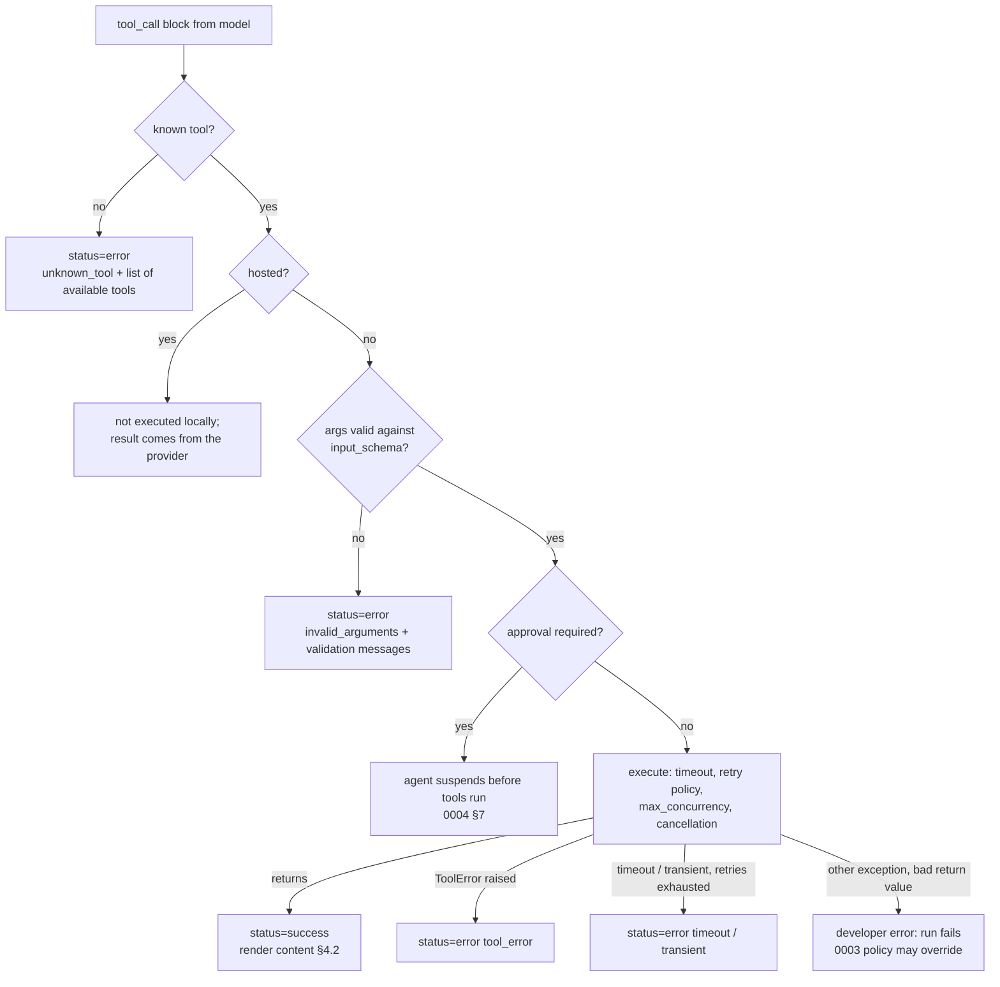

# 0002: Messages, tools, tool calls and tool results

Status: **Partly implemented** in `crates/agentbuild-providers`: the data
types of §1, §2, §3 (`ToolSpec` and registration-time validation), §4 (tool
message fields and statuses) and §7 (request, response, capabilities), and
the transcript check and repair of §6. Not yet: the tool context (§3.1),
result rendering, truncation and state updates (§4.2–§4.4), the tool call
lifecycle (§5, part of the agent loop), adapter normalization (§7.1) and
streaming (§8).

Implementation decisions:

- A tool message is a `Message` with `role: tool` and the extra fields
  `call_id`, `tool`, `status`, `error`, `artifact`, all on the same flat
  object (as in §4), not a separate type. `Message::validate()` enforces
  the role/block table of §1 and the tool-message rules of §4.
- Content-block variants are `#[non_exhaustive]` and built with constructors
  (`ContentBlock::text(..)`, `ContentBlock::tool_call(..)`), so fields can be
  added without breaking users. `tool_call.args` is typed as a JSON object;
  any other JSON is rejected when parsing.
- `reasoning.redacted` holds the provider's opaque redacted reasoning
  (Anthropic `redacted_thinking.data`) as a string.
- `metadata` keeps unknown fields (`other`), so data added by newer SDKs
  round-trips.
- Unknown block types are rejected when parsing (strict now; relaxing is
  compatible).
- Transcript repair inserts missing results right after the tool messages
  that directly follow the assistant message, in call order, with ids
  `msg_repair_<call_id>` (repairing twice is a no-op). A result placed after a
  user message but before the next assistant message is valid, as the
  invariant says; adapters that need contiguous results reorder when encoding.
  An invalid tool call without a name gets `tool: "unknown"` in its inserted
  result.

Related: [0003 error model](0003-error-model.md) ·
[0004 agent loop](0004-agent-loop.md) ·
[0005 core runtime extensions](0005-core-runtime-extensions.md) ·
research: [langchain-agents](../research/langchain-agents.md)

These are the **language-neutral data contracts** that every other agent
feature depends on. They are defined once as JSON shapes, owned by the Rust
core, and mirrored as typed classes in Python and TypeScript. Provider adapters
translate them to and from each vendor's wire format.

## Design goals

1. **One shape across languages.** A message produced in Python, stored, and
   read in TypeScript is the same JSON.
2. **Lossless round-trips.** Provider-specific data (reasoning signatures, cache
   hints, server-tool blocks) is kept in namespaced fields, never dropped.
   Dropping data in another provider's request is explicit and emits a
   `warning` event.
3. **One source of truth.** Tool calls live in the assistant message's content,
   in order. There is no second `tool_calls` list that can drift. SDKs offer a
   derived `message.tool_calls` accessor.
4. **Valid transcripts by construction.** The runtime guarantees that every
   tool call gets exactly one result before the next model call (§6).

---

## 1. Message

```jsonc
{
  "id": "msg_01J…",            // required; unique within a conversation. Generated if absent.
  "role": "system" | "user" | "assistant" | "tool",
  "content": [ /* ContentBlock, ordered */ ],
  "name": "researcher",        // optional participant / agent name
  "metadata": {                // optional; never sent to the model
    "model": "claude-…", "provider": "anthropic",
    "usage": { "input_tokens": 0, "output_tokens": 0,
               "cache_read_tokens": 0, "cache_write_tokens": 0, "reasoning_tokens": 0 },
    "finish_reason": "stop" | "tool_calls" | "length" | "content_filter" | "error" | "other",
    "raw_finish_reason": "end_turn",
    "created_at": "2026-10-11T12:00:00Z"
  }
}
```

**Usage semantics:** `input_tokens` counts *all* input processed, including
cache reads and writes; `cache_read_tokens` and `cache_write_tokens` are
subsets of it. Adapters normalize providers that report them separately
([0006 §9](0006-provider-layer.md) Q4).

Tool messages have extra required fields (see §4).

| Role | May contain |
|---|---|
| `system` | text |
| `user` | text, image, audio, file |
| `assistant` | text, reasoning, tool_call, invalid_tool_call, provider |
| `tool` | text, image, file, json (plus the result fields in §4) |

The SDKs build messages for users (`user("hi")`, `Message.user("hi")`). Users
rarely write blocks by hand.

## 2. Content blocks

Every block has `type` and may have `extras: { "<provider>": { … } }` for
provider-specific fields (for example `extras.anthropic.cache_control`).

| `type` | Fields | Notes |
|---|---|---|
| `text` | `text` | |
| `reasoning` | `text?`, `signature?`, `redacted?` | Opaque data must round-trip unchanged for the same provider. |
| `image` / `audio` / `file` | `source: {kind: "url"\|"base64"\|"file_id", …}`, `mime_type` | |
| `json` | `value` | Structured data, mainly in tool results. |
| `tool_call` | `id`, `name`, `args` (JSON **object**) | Only in assistant messages. |
| `invalid_tool_call` | `id`, `name?`, `raw_args` (string), `error` | The model produced arguments that could not be parsed. |
| `provider` | `provider`, `data` | Escape hatch for blocks we don't model (e.g. server-side tool use). Sent back only to the same provider. |

## 3. Tool definition (ToolSpec)

The SDKs infer a ToolSpec from a function: type hints and Pydantic in Python,
Zod or TypeScript types in TS. MCP tools arrive as ToolSpecs directly. The core
only ever sees the JSON form.

```jsonc
{
  "name": "search_docs",                 // ^[a-zA-Z0-9_-]{1,64}$, unique per agent
  "description": "Search the docs …",
  "input_schema": { "type": "object", "properties": { … }, "required": [ … ],
                    "additionalProperties": false },
  "kind": "function" | "mcp" | "hosted", // hosted = executed by the provider, never locally
  "annotations": {                        // hints that drive runtime policy (§5)
    "read_only": false, "idempotent": false, "destructive": false
  },
  "timeout_ms": 30000,                    // optional, per call
  "max_concurrency": null,                // e.g. 1 = calls to this tool run one at a time
  "return_direct": false,                 // a successful call ends the agent loop (0004 §4)
  "max_result_chars": 100000              // see §4.3
}
```

**Registration-time validation** (fails the agent build, like `ValidationIssue`):
invalid or duplicate names, an `input_schema` that is not an object schema, or a
reserved name (`final_output` is reserved for structured output, 0004 §6).

### 3.1 What a tool function receives

```python
@tool
async def search_docs(query: str, limit: int = 5, *, ctx: ToolContext) -> list[Hit]: ...
```

- **Arguments** come from the model, validated against `input_schema` (§5.1).
- **`ctx`** is optional and never part of the schema, so the model cannot forge
  it. It holds `call_id`, `run_id`, a read-only view of the state, the run's
  `context` (app dependencies such as a DB client), `emit(event)` for
  progress, the cancellation signal (`asyncio` cancellation / `AbortSignal`),
  and the remaining deadline.

This replaces LangChain's three injection mechanisms (`InjectedState`,
`InjectedStore`, `ToolRuntime`) with one parameter.

## 4. Tool result (tool message)

```jsonc
{
  "id": "msg_…",
  "role": "tool",
  "call_id": "call_abc",          // required; matches a tool_call.id in the preceding assistant message
  "tool": "search_docs",
  "status": "success" | "error" | "rejected" | "skipped" | "cancelled",
  "content": [ /* what the model sees */ ],
  "error": { "code": "tool_error", "message": "…", "retryable": false },   // when status = error
  "artifact": { /* app-only data, never sent to the model */ },
  "metadata": { "duration_ms": 41, "attempts": 1, "truncated": false }
}
```

### 4.1 Status meanings

| Status | Produced when | Model sees |
|---|---|---|
| `success` | The tool returned normally | Its output |
| `error` | A model-recoverable failure (0003 §3): bad arguments, unknown tool, `ToolError`, timeout after retries | `Error: <message>`; adapters also set the provider's error flag, e.g. Anthropic `is_error` |
| `rejected` | A human rejected the call (0004 §7) | The reviewer's message, or a default "rejected by reviewer, do not retry" |
| `skipped` | Not executed because of a policy: per-turn call cap, final output given in the same turn, or a sibling failure under `fail_run` | Why it was skipped |
| `cancelled` | The run was cancelled while the call was in flight | Written only by transcript repair (§6) |

### 4.2 How return values become content

| Tool returns | `content` | Other fields |
|---|---|---|
| `str` | one `text` block | |
| JSON-serializable value (dict, list, number, Pydantic model, plain object) | one `json` block; adapters render it as compact JSON text where the provider has no structured result | |
| Content blocks (e.g. an image) | as given | |
| `ToolResult(content=…, artifact=…, state_update=…)` | as given | `artifact` stored; `state_update` merged (§4.4) |
| `None` / `undefined` | one `text` block: `"(no output)"` | |
| Anything not serializable (sockets, functions, NaN, cycles) | — | **Developer error** `invalid_tool_result`; fails the run (0003) |

If a provider cannot accept a block type in tool results (e.g. images in some
chat APIs), the adapter degrades it to a text placeholder and emits a
`warning` event. It never drops the block silently.

### 4.3 Oversized results

If the rendered content exceeds `max_result_chars` (default 100,000 per call,
configurable per tool and per agent), it is cut, and a visible marker is
appended: `[truncated: 48,213 more characters]`. The full value stays in
`artifact`, `metadata.truncated` is set, and a `warning` event is emitted. The
limit exists because of a real constraint, the model's context window.

### 4.4 State updates from tools

A tool may return `state_update` to change agent state (e.g. a to-do list). The
updates from one tools step are merged **in tool-call order**, using the
same per-key rules as the core (0001; reducers in 0005). Two parallel calls
writing the same `replace` key is an `update_conflict` developer error. Use an
`append` or `upsert` key when parallel writes are expected.

## 5. Tool call lifecycle



### 5.1 Argument validation

- Validation runs in the **core** against the JSON Schema, so Python, TS, MCP
  and future Rust tools behave the same. Error messages name the field
  path (`limit: expected integer, got "five"`) so the model can correct itself.
- The SDK then parses the arguments into typed values (Pydantic/Zod). A parse
  failure there is reported the same way (`invalid_arguments`).
- Unknown keys are rejected when the schema says `additionalProperties: false`.
  This is the default for inferred schemas.

### 5.2 Execution rules

- **Concurrency.** All calls from one assistant message run concurrently inside
  the tools node, bounded by `max_parallel_tool_calls` (default 8) and by each
  tool's `max_concurrency`. Calls limited by `max_concurrency` run in call
  order.
- **Result order.** Tool messages are appended in **tool-call order**, not
  completion order, so transcripts are deterministic.
- **Retries.** Tools are **not retried by default**, because retrying
  `send_email` is dangerous. A tool is retried on transient errors only if it is
  annotated `idempotent` or `read_only`, or has an explicit retry policy
  (0003 §5).
- **Timeouts.** Per-call `timeout_ms`, also bounded by the run deadline.
- **Atomicity.** A failed tools step commits **no state** (0001). External side
  effects of tools that already finished **cannot be undone**. They are not
  hidden, though:
  - each finished call's result is saved immediately in the task memo
    (0005 §1, §5.1), so resuming the failed run's snapshot **does not run
    those calls again**;
  - they are listed in the error's `details.completed_calls`, so the app can
    compensate if it does not resume.

## 6. Transcript validity (invariant)

Providers reject transcripts where an assistant `tool_call` has no matching tool
message. The runtime guarantees:

> Before every model call, each `tool_call` in the transcript has exactly one
> tool message with the same `call_id`, placed after its assistant message and
> before the next assistant message.

The **agent model node repairs** violations before calling the model. They arise
from failed or cancelled runs, an app editing state, or resuming an old
snapshot:

| Violation | Repair |
|---|---|
| tool_call without result | Insert a `cancelled` result: "This call did not complete." |
| result without matching call | Remove it; emit `warning` |
| two results for one call | Keep the first; emit `warning` |
| `invalid_tool_call` without result | Insert an `error` result: "Arguments could not be parsed: …" |

Every repair emits a `transcript_repaired` event listing the changes. Repairs
are recorded in state (append/upsert), never by rewriting the whole history.

## 7. Model request and response (provider contract)

```jsonc
// ModelRequest
{
  "messages": [ … ],
  "tools": [ ToolSpec … ],
  "tool_choice": "auto" | "none" | "required" | { "name": "…" },
  "output": { "schema": { … }, "strategy": "native" | "tool" },   // optional, 0004 §6
  "settings": { "max_tokens": 4096, "temperature": 0.2, "stop": [], "parallel_tool_calls": true,
                "reasoning": { "effort": "medium" } },     // or { "budget_tokens": 8000 }; mapped per protocol
  "extras": { "<provider>": { … } }
}
// ModelResponse
{ "message": { /* assistant message */ }, "usage": { … }, "finish_reason": "…" }
```

Wire mappings for each protocol and the provider layer that implements this
contract: [0006](0006-provider-layer.md).

**Capabilities** are declared by each adapter, never guessed from model names:
`tools`, `parallel_tool_calls`, `native_structured_output`, `streaming`,
`vision`, `reasoning`, `tool_result_images`, `max_context_tokens`.

### 7.1 Normalization the adapter must do

| Provider behaviour | Normalized to |
|---|---|
| tool call without an id | id `call_<uuid>`; original kept in `extras` |
| duplicate tool-call ids in one message | later duplicates get fresh ids; `warning` |
| arguments that are not valid JSON, or are a non-object | `invalid_tool_call` with `raw_args` and parse error |
| output cut off mid-tool-call (`length`) | `invalid_tool_call` with error `"truncated"` |
| tool call to a name not in `tools` | kept as `tool_call`; the agent answers with `unknown_tool` (§5) |
| vendor finish reasons | the 6 normalized values plus `raw_finish_reason` |
| HTTP or SDK errors | `ModelError` with a classified `kind` (0003 §4) |

## 8. Streaming deltas

Adapters stream `message_delta` events, and the runtime assembles them:

```jsonc
{ "type": "message_delta", "message_id": "msg_…", "index": 2,
  "delta": { "type": "text", "text": "Hel" } }
{ "type": "message_delta", "message_id": "msg_…", "index": 3,
  "delta": { "type": "tool_call", "id": "call_1", "name": "search_docs", "args_fragment": "{\"qu" } }
```

Deltas are applied by block `index`. `args_fragment` strings are concatenated
and parsed when the block ends; a parse failure turns the block into an
`invalid_tool_call`. A final `message_completed` event carries the **assembled,
authoritative message**, so consumers never need to merge deltas themselves.

## 9. Edge cases (summary)

| Case | Behaviour |
|---|---|
| Assistant message with text **and** tool calls | Both kept; the loop continues to tools |
| Empty assistant message | Treated as a final answer with empty text; `warning` event |
| Model calls the same tool twice with the same args | Both run (they may be legitimately different calls); use `max_concurrency` or idempotency in the tool if this matters |
| 50 tool calls in one turn | Run up to `max_parallel_tool_calls` at a time; calls beyond `max_tool_calls_per_turn` (default 32) get `skipped` |
| Tool name differs only by case | Treated as unknown (`unknown_tool`, with the available names listed) |
| Arguments contain keys reserved by the SDK (e.g. `ctx`) | Impossible to inject: `ctx` is not in the schema and unknown keys are rejected |
| Hosted (provider-side) tool | Never executed locally; its blocks stay `provider` blocks and round-trip to the same provider |
| Switching provider mid-conversation | `provider` blocks and `reasoning` signatures from another vendor are omitted from the request, with a `warning` |
