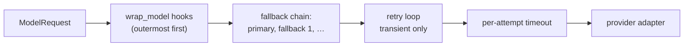

# 0003: Error model

Status: **Proposed** (design phase). Extends the implemented run errors in
[0001](0001-execution-model.md). Related: [0002](0002-messages-and-tools.md),
[0004](0004-agent-loop.md), [0005](0005-core-runtime-extensions.md).

## Why this matters

In agent systems, errors decide reliability, cost and safety. The LangChain
study ([research](../research/langchain-agents.md) §1.7, §7.3) found the
opposite of what we want:

- Tool exceptions crash the run by default.
- An exhausted model retry quietly turns into a fake assistant message.
- Interrupts are exceptions that every `except Exception` must remember to
  re-raise.

CriogenAI's rule:

> **Every failure has exactly one category, one stable code, one documented
> default action, and leaves behind a valid transcript and an exact account of
> what happened.**

---

## 1. Principles

1. **Classify by who can fix it.** The category decides the default action, not
   the place where the error was raised.
2. **Errors stay errors.** Nothing is converted into fake model output. Turning
   an error into a tool result for the model is an explicit, documented policy.
3. **No exceptions as control flow.** Suspension (human-in-the-loop) and
   cancellation are *outcomes*, not errors that user code might swallow.
4. **Same behaviour in every language.** Classification, retries, timeouts and
   limits run in the Rust core. SDKs only translate errors into idiomatic
   exceptions.
5. **Preserve the cause.** In-process, the original exception object is kept as
   the cause. Across serialization, the type, message and traceback text are kept.
6. **State is atomic, side effects are not.** A failed step commits no state
   (0001). External effects that already happened are *reported*, not hidden.
7. **Never lose the primary error.** Failures during cleanup, error handling or
   serialization are attached as secondary errors.

---

## 2. Run outcomes

A run (or a resumed segment of one) ends in exactly one outcome:

| Outcome | Meaning | Python | TypeScript |
|---|---|---|---|
| `completed` | Finished normally | returns `RunResult` | resolves `RunResult` |
| `suspended` | Waiting for external input (0004 §7) | returns `RunResult` with `.status == "suspended"`, `.interrupt`, `.snapshot` | same |
| `failed` | An error ended the run | raises `CriogenError` subclass | rejects with `CriogenError` |
| `cancelled` | The caller cancelled, or the parent run was cancelled | raises `asyncio.CancelledError` | rejects with `AbortError` (`signal.reason`) |

Suspension is **returned**, not raised, because it is an expected outcome.
Cancellation uses each language's native mechanism, so existing cancellation
code keeps working.

---

## 3. Categories (who can fix it)

| Category | Who fixes it | Examples | Default action |
|---|---|---|---|
| **model_recoverable** | The model, on its next turn | unknown tool, invalid arguments, `ToolError` raised by a tool, tool timeout after retries, an exception a tool did not handle (by default, §5.1) | Send it to the model as a tool result with `status: error`; continue |
| **transient** | Time | HTTP 429/5xx, overload, network reset, per-attempt timeout | Retry with backoff where allowed (§5); then escalate to the next category's action |
| **developer** | The developer | uncaught exception in a hook, a tool's exception with `on_tool_exception="fail"`, `ToolError::fatal`, invalid tool return value, JSON conversion failure, state update conflict, bad configuration | **Fail the run.** Never shown to the model. |
| **provider_fatal** | The developer or operator | auth, permission, unknown model, invalid request, context overflow, content filter | Fail the run without retrying (a hook may handle context overflow, §6) |
| **policy** | Configuration | model-call limit, tool-call limit, step limit, deadline, nesting limit | Fail with a `limit_exceeded`-family code, or end gracefully if configured (0004 §5) |
| **human** | A reviewer | rejected tool call | Send it to the model as `status: rejected`; continue |
| **cancellation** | The caller | `cancel()`, abort signal, parent cancelled | Stop; outcome `cancelled` |
| **internal** | CriogenAI maintainers | Rust panic in the runtime, broken invariant | Fail with code `internal`; bug report requested |

---

## 4. Classifying model-provider errors

Adapters must map every provider failure to a `ModelError.kind`. Retry logic is
then generic and identical for all providers.

Status: **implemented** in `criogenai-providers` (`ModelErrorKind`,
`ModelError`, `classify_http` for HTTP failures in the shapes of OpenAI,
Anthropic, Ollama, vLLM, llama.cpp and Google (Gemini), `Retry-After` in all three forms,
message sanitization). Transport failures (`network`, `timeout`,
`dispatch=not_sent`) are classified when the HTTP transport exists.

| `kind` | Typical source | Category | Retried by default |
|---|---|---|---|
| `rate_limited` | 429 | transient | yes, honoring `retry_after` (§5.2) |
| `overloaded` | 529, "overloaded" | transient | yes |
| `server` | 500, 502, 503, 504 | transient | yes |
| `timeout` | per-attempt timeout, read timeout | transient | yes |
| `network` | connection reset, DNS failure, TLS error | transient | yes |
| `auth` | 401, missing or invalid key | provider_fatal | no |
| `permission` | 403 | provider_fatal | no |
| `not_found` | unknown model or endpoint | provider_fatal | no |
| `invalid_request` | 400 (schema problem, bad parameter) | provider_fatal | no |
| `context_overflow` | prompt too long | provider_fatal (hook-handleable) | no |
| `content_filter` | provider refuses the request with an error | provider_fatal | no |
| `quota_exhausted` | billing / quota exhausted (e.g. 429 `insufficient_quota`, 402) | provider_fatal | no (a fallback to another vendor is allowed) |
| `invalid_response` | 2xx with an unparseable body | provider_fatal | no (already billed) |
| `unknown` | anything unclassified | provider_fatal | no |

Every `ModelError` carries `provider`, `model`, `status` (HTTP),
`provider_code`, `retry_after_ms`, `request_id`, `dispatch`
(`not_sent` | `sent` | `streaming`; see [0006 §3](0006-provider-layer.md)) and a
sanitized `message`. `not_sent` errors are always safe to retry or fall back
immediately.

**Content filtering returned as a normal response** (a refusal message with
`finish_reason: content_filter`) is *not* an error. The agent ends with
`stop_reason: "content_filter"` and returns that message. The two cases are
deliberately distinct: the provider refused the request vs. the model declined
in its answer.

---

## 5. Policies and defaults

### 5.1 Defaults

| | Model calls | Tool calls |
|---|---|---|
| Per-attempt timeout | 120 s (connect 10 s; **idle between stream chunks 60 s**) | tool's `timeout_ms`, else 60 s |
| Retries on transient errors | 2 retries (3 attempts) | **0**, unless annotated `idempotent` / `read_only` or given an explicit policy |
| Backoff | exponential, base 0.5 s, factor 2, cap 20 s, full jitter | same, when enabled |
| After retries are exhausted | fallback models if configured, else fail `model_failed` | `status: error` result to the model (`timeout` / `transient`) |
| `ToolError` raised | — | `status: error` result to the model |
| Unexpected exception | fail `model_failed` (`kind: unknown`) | `status: error` result to the model, code `tool_failed`, with the exception's type and message (`on_tool_exception`: `"return_to_model"`, the default; `"return_generic"` sends only "the tool failed", keeping the text in the result's `artifact`; `"fail"` fails the run with `tool_failed`, the exception as its cause). A Rust tool's panic counts as an exception. |

Every value is configurable per agent, per tool and per model. Policies are
**declarative data**, executed by the core, so Python and TypeScript agents
behave identically.

### 5.2 Retry rules

- **Deadline-aware.** Never sleep past the run deadline. If the next backoff
  would cross it, fail with `deadline_exceeded`.
- **`retry_after`.** Wait exactly that long if it is ≤ `max_retry_after`
  (default 60 s). Otherwise fail immediately with `rate_limited`, rather than
  hanging for minutes.
- **Cancellation wins.** Cancellation during a backoff sleep ends the run as
  `cancelled`.
- **Streaming restarts are visible.** If a stream fails after deltas were
  emitted, the runtime emits `message_aborted { message_id }` before retrying,
  and the retry uses a new `message_id`. UIs can discard the partial text.
- **Every attempt is recorded** with an `attempt_failed` event (kind, delay)
  and in `metadata.attempts`.

Status (2026-10-12): **implemented** for agent model calls in
`criogenai-agent` (`resilience.rs`): retries of transient kinds with the
node's `RetryPolicy` backoff, `Retry-After` honored up to
`max_retry_after` (default 60 s, longer waits fail or fall back at once),
`not_sent` retried immediately, fallback models (at once on
`rate_limited`/`overloaded`, after exhausted retries on other transient
kinds, and on kinds listed in `fallback_on`), provider `extras` of earlier
models removed, waits that would cross the run deadline fail with
`deadline_exceeded`, `model_attempt_failed` / `model_fallback` /
`message_aborted` events. Model attempts are not counted as model calls.

### 5.3 Composition order (model call)



Hooks see the final result of the whole retry and fallback chain. A
summarization hook can therefore catch `ContextOverflowError` and call
`handler()` again with a trimmed request.

Fallback moves to the next model only on transient errors that have exhausted
their retries, or on kinds listed in `fallback_on` (default:
`overloaded`, `server`, `timeout`). Before each fallback attempt, request
`extras` belonging to the previous provider are removed.

---

## 6. Error representation

### 6.1 Canonical error object (JSON, language-neutral)

```jsonc
{
  "code": "model_failed",                 // stable snake_case; see catalog §9
  "category": "transient",                // §3
  "message": "anthropic rate_limited after 3 attempts",
  "retryable": true,                      // safe for the *caller* to retry the whole run
  "run_id": "run_…", "step": 7, "node": "model",
  "call_id": null, "tool": null,
  "details": { "kind": "rate_limited", "provider": "anthropic", "attempts": 3,
               "usage": { "input_tokens": 51234, "output_tokens": 2201 },
               "completed_calls": [] },
  "cause": {                              // chain, innermost last
    "code": null, "kind": "anthropic.RateLimitError",
    "message": "…", "traceback": "…"      // traceback is text, never sent to models
  },
  "secondary": [ ]                        // errors raised during cleanup or handling
}
```

`NodeError` (0001) gains an optional **`code`** next to `kind`:

- `kind` is the language-level type (`ValueError`, `TypeError`).
- `code` is the framework meaning (`model_failed`).

The SDK surfaces the **innermost framework code**. A model failure inside the
model node is reported to the user as `ModelError`, not as a generic
`node_failed`.

### 6.2 Python

```
CriogenError                      .code .category .retryable .details .run_id .step .node
├── WorkflowBuildError               .issues            (ValidationIssue list)
├── RunFailedError                   node/router failures; __cause__ = the original exception
│   ├── UpdateConflictError, RoutingError, StepLimitError
│   ├── NodeTimeoutError, DeadlineExceededError
├── ModelError                       .kind .provider .model .status .retry_after
│   ├── RateLimitError, ModelUnavailableError (overloaded/server/network/timeout)
│   ├── AuthenticationError, ContextOverflowError, ContentFilterError, InvalidRequestError
├── ToolExecutionError               .tool .call_id; __cause__ = the tool's exception
├── InvalidToolResultError           .tool .call_id .path
├── OutputValidationError            .errors (validation messages), .raw
├── LimitExceededError               .limit ("model_calls" | "tool_calls" | "steps" | …) .value
├── HookError                        .hook .middleware; __cause__
├── ValueConversionError             .path  (e.g. "$.results[3].score": NaN not allowed)
└── ResumeError                      .reason ("resume_invalid" | "workflow_mismatch")

ToolError(Exception)                 raised BY tool authors to send an error to the model
```

`ToolError` deliberately does not inherit from `CriogenError`. It is a message
from a tool author to the model, not a framework failure. Catching
`CriogenError` must never swallow it.

### 6.3 TypeScript

`class CriogenError extends Error` with a readonly `code` discriminant, the
same fields as the JSON, and standard `cause` (ES2022). Subclasses mirror the
Python tree. Type guards: `isCriogenError(e)` and `isCriogenError(e, "model_failed")`.
`ToolError` is a separate class. Cancellation surfaces as the `AbortSignal`'s
reason (an `AbortError` by default).

### 6.4 Sanitization

- Configured credentials (API keys, tokens) are **redacted** from messages,
  details and causes before an error is emitted or serialized.
- Tracebacks are kept for developers (logs, the error object) and **never**
  sent to a model.
- Error messages sent to models are short: the `ToolError` message or a
  validation summary. Internal types and paths are left out.

---

## 7. Propagation through the layers

```mermaid
sequenceDiagram
    participant Tool as Tool (Python)
    participant Bridge as Python bridge
    participant ToolsNode as tools node (Rust)
    participant Core as Core run loop
    participant SDK as SDK caller

    Tool->>Bridge: raise ToolError("not found")
    Bridge->>ToolsNode: CallOutcome::ModelRecoverable{tool_error}
    ToolsNode->>Core: Update{messages+: tool msg status=error}
    Note over Core: step commits; loop continues to model

    Tool->>Bridge: raise KeyError("x")  (unexpected)
    Bridge->>ToolsNode: CallOutcome::Developer{kind:"KeyError", cause handle}
    ToolsNode->>Core: NodeError{code:"tool_failed", ...}
    Note over Core: step NOT committed; siblings cancelled
    Core->>SDK: RunError{node_failed → tool_failed}
    SDK-->>SDK: raise ToolExecutionError from KeyError (original object)
```

The bridge keeps a handle to the **original exception object**, so in-process
callers get the real `__cause__` with its traceback. The JSON form is used only
for events, logs and serialization.

### Nested runs (an agent used inside a tool)

A failure in a nested run is an exception inside the tool, so the parent applies
its normal policy: unexpected means a developer error. The `agent.as_tool()`
helper converts the nested run's **model_recoverable** and **policy** failures
into a `ToolError` for the parent model, and lets developer, provider_fatal and
internal errors propagate. Cancellation propagates downward: cancelling the
parent cancels nested runs.

---

## 8. Cancellation, timeouts and cleanup

| Mechanism | Scope | Error / outcome |
|---|---|---|
| `run.cancel()`, an `AbortSignal`, or dropping the future (Rust) | whole run | outcome `cancelled` |
| run `deadline` | whole run, including retries and backoff | `deadline_exceeded` (policy) |
| node `timeout` (core) | one node execution | `node_timeout` (developer, unless the node is the model or tools node, which convert to their own policies) |
| model attempt timeout | one provider call | `ModelError{kind: timeout}`, transient |
| tool `timeout_ms` | one tool call | `status: error, code: timeout` after retries |

**Cooperative cancellation.** Async Python tools are cancelled with
`task.cancel()`; TS tools receive `ctx.signal`. **Sync Python tools** run on
a thread pool and **cannot be force-stopped**. After the timeout or
cancellation, the runtime stops waiting, discards the result and emits
`warning: tool_abandoned`, while the thread keeps running until it returns. Async
tools are recommended for anything long-running.

**Grace period.** On cancellation, in-flight work has `cancel_grace` (default
5 s) to finish cleanup before the run reports `cancelled`.

**Cleanup ordering.**
1. Cancel in-flight nodes and tools.
2. Wait for them, up to the grace period.
3. Run `on_end` hooks with the outcome (0004 §3). They run on completed, failed,
   cancelled *and* suspended segments.
4. Return the outcome.

An error raised in step 3 is added to `secondary` and never replaces the
primary error.

---

## 9. Error code catalog

Codes are stable API: they may be added, never renamed or removed before 1.0
without a deprecation cycle. **The authoritative list is
[`schemas/error-codes.json`](../../schemas/error-codes.json)**, shown as
[`docs/errors.md`](../errors.md) (design 0013): tests fail when the Rust
sources raise a code it lacks, when the page differs from it, or when an
SDK maps a code to the wrong class. The table below is the original design
record; where they differ, the catalog wins.

| Code | Category | Raised by | Status |
|---|---|---|---|
| `node_failed` | developer | core: a user node raised | implemented |
| `node_panicked` | developer | core: a Rust node panicked | implemented |
| `router_failed` | developer | core | implemented |
| `unknown_route` | developer | core | implemented |
| `update_conflict` | developer | core | implemented |
| `step_limit_exceeded` | policy | core | implemented |
| `node_timeout` | developer | core: node attempt exceeded its policy timeout | implemented |
| `deadline_exceeded` | policy | core: run deadline (also cuts backoff short) | implemented |
| `cancelled` | cancellation | core: `CancelToken::cancel` (an outcome in the SDKs, `RunError` in Rust) | implemented |
| `invalid_value` | developer | core: a write a reducer cannot apply; storage: a memory key, value or namespace it does not accept (0008 §13); bridge: JSON conversion | implemented (core, storage) |
| `invalid_state` | developer | agent: the state is not an agent's (bad `messages`), or `Memory` cannot resolve the run's namespace (0008 §13) | implemented |
| `invalid_input` | developer | agent: `AgentInput::with` names one of the agent's own keys (0008 §13) | implemented |
| `missing_goto` | developer | core: goto-only node returned no target | implemented |
| `resume_invalid` | developer | core: bad resume input | implemented |
| `workflow_mismatch` | developer | core: snapshot from a different graph | implemented |
| `storage_failed` | transient | core: the run's `Persister` failed (0008 §12); `details` / the `NodeError` kind carry the storage code | implemented |
| `audit_failed` | transient | an audit record could not be written, so the action failed (0010 §4) | implemented |
| `internal` | internal | anywhere | proposed |
| `model_failed` | per `kind` | agent: model node | proposed |
| `tool_failed` | developer | agent: unexpected tool exception | proposed |
| `invalid_tool_result` | developer | agent: unserializable tool return value | proposed |
| `output_invalid` | model_recoverable → policy | agent: structured output still invalid after retries | proposed |
| `limit_exceeded` | policy | agent: model-call, tool-call, token or nesting limit | proposed |
| `hook_failed` | developer | agent: middleware raised | proposed |

Storage codes (`thread_busy`, `storage_unavailable`, `storage_conflict`,
`checkpoint_not_found`, `storage_corrupt`, `storage_incompatible`,
`thread_suspended`, `thread_interrupted`) are defined in
[0008 §8](0008-persistence-and-memory.md).

Tool-result error codes (inside tool messages, not run errors): `unknown_tool`,
`invalid_arguments`, `tool_error`, `timeout`, `transient`.

---

## 10. Edge cases

| # | Case | Behaviour |
|---|---|---|
| E1 | Two parallel tools raise unexpected exceptions | Fail-fast: the first observed is primary; siblings are cancelled; any errors that had already completed are listed in `details.other_failures` |
| E2 | One parallel tool fails the run after another tool already sent an email | State is not committed. The email call's result is saved in the task memo and listed in `details.completed_calls`. Resuming `error.snapshot` after the fix reuses it, so the email is **not sent twice**; an app that does not resume can compensate. Atomicity covers state; side effects are recorded, not undone |
| E3 | Tools step failed; the user starts a new run on the same conversation | The committed transcript has dangling tool calls; transcript repair (0002 §6) inserts `cancelled` results before the next model call |
| E4 | Model stream breaks after 200 tokens | `message_aborted`, then retry with a new message id; partial text is never committed to state |
| E5 | `retry_after` is 10 minutes | Fail now with `rate_limited` (exceeds `max_retry_after`) instead of hanging |
| E6 | Backoff would cross the deadline | Fail with `deadline_exceeded` immediately |
| E7 | Python tool raises `KeyboardInterrupt` / `SystemExit` | Not caught as a tool error: the run is cancelled and the exception is re-raised to the caller after cleanup |
| E8 | Python tool raises `asyncio.CancelledError` without the run being cancelled | Treated as an unexpected exception (`tool_failed`); a tool must not cancel itself silently |
| E9 | JS tool throws a non-Error value (`throw "oops"`) | Wrapped: `kind: "NonErrorThrown"`, `message: "oops"` |
| E10 | Tool returns `float('nan')`, a 2^70 integer, bytes, or a dict with non-string keys | `invalid_tool_result` with the JSON path. No silent coercion |
| E11 | The `on_end` hook raises while handling a failure | Primary error kept; hook error in `secondary` |
| E12 | An error's `details` are not JSON-serializable | Replaced by a string representation; the primary error is never lost |
| E13 | Provider error message contains the API key | Redacted before emission (§6.4) |
| E14 | Exhausted retries on a model call | Fail with `model_failed` (`retryable: true`). **Never** turned into an assistant message |
| E15 | Context overflow with a summarization hook installed | The hook catches `ContextOverflowError` in `wrap_model`, trims the request and calls `handler()` again; without a hook, the run fails `model_failed` (`kind: context_overflow`) |
| E16 | Nested agent (as a tool) hits its model-call limit | `as_tool()` converts it to a `ToolError` for the parent model; a nested `auth` error propagates and fails the parent |
| E17 | Cancellation arrives while the run is suspended | Nothing is running; `cancel()` on a suspended handle is a no-op. The app discards the snapshot |
| E18 | Usage and cost when a run fails | Token usage so far is in `details.usage` on every failure, so cost accounting is never lost |
