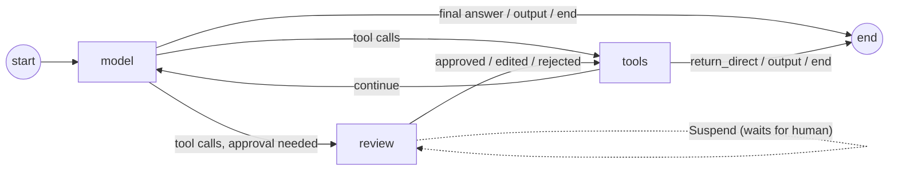
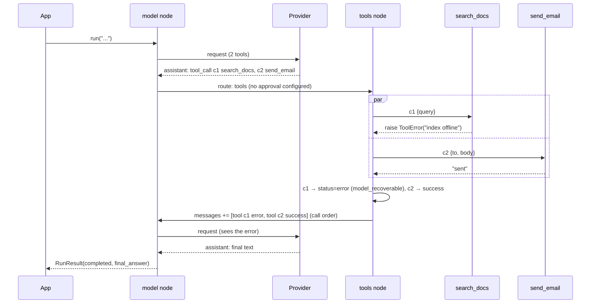

# 0004: Agent loop, hooks, structured output and human-in-the-loop

Status: **Partly implemented** in `crates/agentbuild-agent`: slice 1 (the
graph of §2, the model node and routing of §4.1–§4.2
(without hooks and structured output), the tools node of §4.3, the limits
`model_calls`, `tool_calls`, `tool_calls_per_turn`, `parallel_tool_calls`
of §5, and the events of §8 that apply), slice 2 (human approval, §7) and
slice 3 (structured output, §6), slice 4 (hooks, §3) and slice 5 (the
remaining limits of §5 except `nesting`). Not yet: `nesting` (comes with
agents as tools), agents as nodes or tools.

Implementation decisions (slice 8, tool features, 0002 §3–§5):

- `ToolSpec.max_concurrency`: a per-tool semaphore (FIFO) inside the run's
  `parallel_tool_calls` bound.
- Retries only for tools annotated `read_only` or `idempotent`, after a
  retryable `ToolError` or a timeout, with `AgentBuilder::tool_retry`
  (default 3 attempts); event `tool_retry`; `metadata.attempts`.
- Results longer than `max_result_chars` (the tool's, else
  `Limits::max_result_chars`, 100,000) are cut with `[truncated: N more
  characters]`; the full content goes to the message's `artifact` (next to
  the tool's own artifact if it set one), `metadata.truncated`, a
  `warning` event `tool_result_truncated`. Non-text blocks are kept.
- `ToolOutput::with_artifact(v)` / `with_state(key, v)` (→ `Rich`). State
  writes are merged in call order: lists for one key are joined, any other
  overlap is `update_conflict`; writing `messages`, `agent` or `hooks` is
  `tool_failed`.
- Memo entries for finished calls now hold the message, its state writes
  and its `return_direct` value (older entries holding only a message are
  still read), so a retried step keeps them.
- `AgentBuilder::context(T)` + `ToolContext::context::<T>()`: app services
  for tools (agent-wide; per-run context comes with the SDKs).

Implementation decisions (slice 7, agents as nodes and tools):

- `agent.as_node()` → `AgentNode` (`messages_key`, default `messages`; a
  string there is taken as one user message; optional `output_key`). It
  runs the agent as a nested run inside the node (cancellation and the
  remaining deadline are passed down) and writes the full transcript and
  the output back. Approval inside the agent suspends the workflow with
  `{"kind": "agent_approval", "requests"}`; the agent's snapshot is kept in
  the node's task memo, which travels with the workflow snapshot, so
  `workflow.resume(snapshot, [(node, {call_id: decision})])` continues it.
  A failed agent's snapshot is kept the same way, so retrying the workflow
  retries the agent (its finished tool calls are not repeated). Agent
  error codes become the node error's `kind`.
- `agent.as_tool(name, description)` → `AgentTool` with arguments
  `{"input": string}`. Output text or JSON is the result. `limit_exceeded`,
  `output_invalid`, `deadline_exceeded`, `cancelled` and transient model
  failures become tool errors the calling model sees ("sub-agent stopped:
  …"); everything else (auth, broken tools or hooks) is fatal (0003 E16,
  A12). A sub-agent that needs approval is fatal as a tool (use a node).
- `Limits::nesting` (default 8) is checked by the agent being started:
  `depth` comes from `ToolContext::depth()` + 1 and is kept in the run's
  bookkeeping. A refused sub-agent never calls its model.
- Not yet: forwarding a nested run's events into the parent's stream /
  trace (nested agents are separate traces for now).

Implementation decisions (slice 6, model resilience): model retries moved
from the core node policy into the agent (`resilience.rs`), inside the
hooks, so `Retry-After`, immediate retries of unsent requests and fallback
models work as 0003 §5 describes. `AgentBuilder::{model_retry, fallback,
fallback_on, max_retry_after}`.

Implementation decisions (slice 5, limits):

- `Limits::on_limit(OnLimit::Error | OnLimit::End)` (default `Error`) and
  `Limits::tokens(n)` (input + output tokens across the run's model calls).
- All budgets are checked at the start of the model node, in this order:
  `model_calls`, `tokens`, spent tool budget. The tool-call budget is spent
  when a call was `skipped` because of it; the **next** model call then
  applies `on_limit` (the skipped results are committed first).
- `OnLimit::End` ends with stop reason `limit`, `AgentResult::limit` naming
  the budget, the last assistant text as output, and a repaired (valid)
  transcript. `Error` fails with `limit_exceeded`, `details: {limit,
  value}`.

Implementation decisions (slice 4, hooks):

- Rust: `trait Hook { name, on_start, before_model, wrap_model,
  after_model, wrap_tool, on_end }`, every method with a no-op default;
  `AgentBuilder::hook(h)`. Two hooks with one name fail the build.
- `before_model` / `after_model` return a `HookAction`: `state` (saved under
  the `hooks` state key, one entry per hook name, shown to the hook as
  `HookContext::hook_state`), `messages` (before_model: replace the whole
  transcript, for this call and in state; written with `$replace`),
  `message` (after_model: replace the new message), `end(output)` (stop
  reason `hook_end`; the first `end` in execution order wins).
- `wrap_model(request, next)` / `wrap_tool(call, next)` nest with the first
  hook outermost; `next.call(..)` may be called zero or more times
  (`ModelNext` / `ToolNext` are `Clone`). Retries inside `wrap_model` are
  not counted as model calls. A `ToolError` returned by `wrap_tool` is the
  tool's own error.
- `on_start` and `on_end` run around each `Agent::run`, `resume` and
  `retry` call (one run segment), not inside the workflow: running
  `agent.workflow()` directly skips them. `on_start` may save hook state
  (applied on `run`; on `resume`/`retry` the snapshot's state is used as
  is). `on_end` runs for completed, suspended and failed segments, in
  reverse order, and cannot change the outcome. A new run's `run_id` is
  empty in `on_start` (the engine assigns it when the run starts).
- A hook error fails the run with `hook_failed` (`details.hook`,
  `details.stage`); the failure snapshot allows `Agent::retry` after the
  fix.

Implementation decisions (slice 3, structured output):

- `AgentBuilder::output(schema)` picks `native` when the model declares
  `native_structured_output: true`, otherwise `tool` (unknown counts as
  no); `output_with(schema, strategy)` forces one. The schema must be a JSON
  object (a schema document).
- Tool strategy: the reserved `final_output` tool is added to every request
  (`tool_choice` stays `auto`). A schema whose root is not an object is
  wrapped as `{"value": …}` for the tool and unwrapped in the result. When
  a turn contains `final_output`, only the first such call counts; every
  other call of the turn is `skipped` ("the final output was provided in
  this turn"), valid or not, so nothing runs after the model declared it
  is done. Valid → stop reason `output`; invalid → an `invalid_arguments`
  error result with the validation messages, back to the model.
- Native strategy: `ModelRequest.output` carries the schema; the answer
  text is parsed (a surrounding Markdown code fence is removed) and
  validated. Invalid → a user message with the problems, back to the model
  (the model node routes to itself).
- A plain-text answer under the tool strategy gets the reminder "Give your
  final answer by calling the `final_output` tool."
- Each invalid answer or reminder counts against `Limits::output_retries`
  (default 2); one more fails the run with `output_invalid`, details
  `{problem, raw}`. The step limit grows by `2 × output_retries`.
- `final_output` is never gated by approval rules (it is not a user tool).

Implementation decisions (slice 2, approval):

- Rust API: `Approval::new().tool("send_email").rule(ApprovalRule::new(
  "delete_*").decisions([..]).when(|tool, args| ..).describe(|tool, args|
  ..))`; the first matching rule applies; `*` matches any text. A rule
  that matches no tool, or allows no decision, is a build error.
- The `review` node exists only with approval; the step limit becomes
  `3 × model_calls + 4`. The model node routes to `review` when any valid
  call to a known tool is gated; otherwise to `tools`.
- The interrupt payload is `{"kind": "tool_approval", "requests":
  [{call_id, tool, args, description?, allowed}]}`; `AgentResult::
  approval_requests()` reads it.
- `Agent::resume(snapshot, [(call_id, Decision)])` checks the decisions
  **before** resuming (one per request, allowed kind, edited arguments valid
  against the tool's schema, non-empty response, no extra ids): invalid
  input is `resume_invalid` with no run started, so the snapshot stays
  usable. The review node checks again for raw `Workflow::resume` callers.
- Decisions are stored in the `agent` bookkeeping and consumed by the next
  tools step. `edit` keeps the original call in the transcript and prefixes
  the result with a notice of what ran; `reject` gives a `rejected` result
  (default text "The reviewer rejected this call. Do not retry it.");
  `respond` gives a `success` result with the reviewer's text. Neither
  runs the tool.

Implementation decisions (slice 1):

- The graph is `model` ⇄ `tools` with `may_goto` (`model → tools | END`,
  `tools → model | END`); `max_steps` is `2 × model_calls + 4`.
- State: `messages` (`upsert_by_id`), `agent` (bookkeeping: `model_calls`,
  `tool_calls`, `usage`, `stop_reason`, `output`).
- Instructions are sent as the first system message of every request and
  are not stored in the transcript.
- Transcript repair happens in the model node. When it changed something,
  the model node writes the whole list with `$replace`: an inserted result
  must sit before later messages, which an upsert (append) cannot express.
  Repairs are rare, so the cost is acceptable.
- Model calls use `Model::stream`; each delta is a `message_delta` event.
  Transient `ModelError`s become retryable `NodeError`s, so the core node
  retry policy (default 3 attempts) retries them; `Retry-After` is not
  honored yet. Attempts are not counted as model calls.
- Agent error codes travel as `NodeError.kind` (`model_failed`,
  `tool_failed`, `limit_exceeded`, `invalid_state`) and are surfaced by
  `AgentError.code`.
- Tool arguments are validated in Rust with a JSON Schema subset (`type`,
  `properties`, `required`, `additionalProperties`, `items`, `enum`,
  `const`, numeric and length bounds). Unsupported keywords are ignored.
- Each finished call is saved in the tools task's memo under
  `call:<call_id>` before the step ends; `Agent::retry` reuses them. A fatal
  tool error lists `completed_calls` in the error details.
- Result message ids are `msg_result_<call_id>` (deterministic).
- Rust tools: the `Tool` trait and `tool_fn`; `ToolError::new` goes to the
  model, `ToolError::fatal` fails the run.

Builds on [0002](0002-messages-and-tools.md)
(data contracts), [0003](0003-error-model.md) (errors) and
[0005](0005-core-runtime-extensions.md) (core support). Research inputs:
[langchain-agents](../research/langchain-agents.md),
[langgraph](../research/langgraph.md), [langchain-core](../research/langchain-core.md).

## Goals

1. **Small concept count.** A user who wants a guarded agent with tools, approval
   and typed output should need about 12 concepts, not the ~35 counted in
   LangChain 1.x ([research](../research/langchain-agents.md) §7.2).
2. **Fixed, tiny graph.** Middleware never becomes graph nodes. Adding a hook
   does not change checkpoints, event shapes or step budgets.
3. **Bounded by default.** Every agent has a model-call limit. No runaway
   loops.
4. **Errors per 0003.** No fake assistant messages, no exceptions as control
   flow.
5. **Same behaviour in Python and TypeScript**, because the loop, limits,
   retries and routing live in Rust.

---

## 1. Public API (sketch)

```python
from agentbuild import Agent, tool, ToolError, Limits, Approve

@tool
async def search_docs(query: str, limit: int = 5) -> list[dict]:
    """Search the product docs."""
    ...

@tool(destructive=True)
async def send_email(to: str, body: str) -> str:
    """Send an email."""
    ...

agent = Agent(
    model="anthropic:claude-sonnet-5-5",        # or a Model instance
    tools=[search_docs, send_email],
    instructions="You are a support agent.",
    hooks=[Approve(tools=["send_email"])],      # optional middleware
    output=Answer,                              # optional Pydantic / Zod schema
    limits=Limits(model_calls=25),              # defaults shown in §5
)

result = await agent.run("Reset my password", context=deps)
result.status        # "completed" | "suspended"
result.output        # Answer instance (if output=...), else final text
result.stop_reason   # §4.3
result.messages      # full transcript
result.usage         # tokens across all model calls
```

```ts
const agent = new Agent({ model: "anthropic:claude-sonnet-5-5", tools: [searchDocs, sendEmail],
                          instructions: "...", hooks: [approve({ tools: ["send_email"] })] });
const result = await agent.run("Reset my password", { context: deps, signal });
for await (const event of agent.stream("...")) { /* 0005 §6 */ }
```

An `Agent` is also:
- a **node** in a workflow: `workflow.add_node("support", agent)`. It reads and
  writes the `messages` key and its output key.
- a **tool** for another agent: `agent.as_tool(name, description)`. Errors
  convert as in 0003 §7.

---

## 2. The agent graph

The agent compiles into an ordinary core workflow (0001 plus 0005 extensions):



- `review` exists only if a hook requires approval. Otherwise the graph is
  `model ⇄ tools`.
- Each iteration costs 2 supersteps (3 with review). The core `max_steps` is
  derived automatically: `3 × model_calls + 4`.

### 2.1 Agent state

| Key | Reducer (0005 §3) | Contents |
|---|---|---|
| `messages` | `upsert_by_id` | Transcript (0002). Upsert lets repairs and HITL edits replace one message without rewriting history |
| `output` | `replace` | Structured output, when `output=` is set |
| `agent` | `replace` | Run-scoped bookkeeping: `model_calls`, `tool_calls`, `output_retries`, `pending_control`. Not part of the public schema |
| `hooks.<name>` | per hook | State declared by a hook, **namespaced** so two hooks can't collide |

Inside a workflow, the agent's keys are prefixed by the node's name unless
mapped explicitly. Two agents in one workflow can't overwrite each other's
`messages` unless asked to.

---

## 3. Hooks (middleware)

Six hooks. All are optional and run **in-process inside the model or tools
node**.

| Hook | Runs | Receives | Can |
|---|---|---|---|
| `on_start` | Once per run *segment* (each `run` or `resume`) | state, ctx | Set up resources; return a state update; `end` |
| `before_model` | Before each model call | state, ctx | Return a state update; `end` |
| `wrap_model` | Around each model call (retry/fallback chain inside) | request, handler | Change the request (`request.override(...)`); call `handler` 0..n times; replace the response |
| `after_model` | After each model response, before routing | state (with the new message), ctx | Return a state update (e.g. replace the message); `end` |
| `wrap_tool` | Around each tool call | call request, handler | Change arguments or the tool; short-circuit with a result; call `handler` 0..n times |
| `on_end` | Once per segment, **always**: completed, failed, cancelled, suspended | state, ctx, outcome | Clean up; it cannot change the outcome |

### 3.1 Ordering

For `hooks=[A, B, C]`:

- `on_start` and `before_model` run **A → B → C**.
- `after_model` and `on_end` run **C → B → A**.
- `wrap_model` and `wrap_tool`: **A is outermost**, so A's code runs first on the
  way in and last on the way out.

This is the usual "onion" order, now specified in one place instead of spread
over generated graph nodes.

### 3.2 Control

A hook that may stop the loop returns `Control.end(output=None, message=None)`.
There is no `jump_to` and no static `can_jump_to`. Because the agent's graph is
fixed, `end` is the only jump a hook needs. The first `end` wins, in hook order.

### 3.3 Hook rules

- **State** is changed only through returned updates. Hooks receive a read-only
  view and never mutate messages in place.
- **Errors.** An exception in a hook is a developer error: `hook_failed`,
  with the original exception as cause. Two exceptions: inside `wrap_tool`, a
  `ToolError` is treated as the tool's own error, and inside `wrap_model`, a
  `ModelError` passes through unchanged.
- **Sync or async.** Python accepts both and adapts automatically, so there is
  no runtime `NotImplementedError` as in LangChain. Sync hooks run inline and
  must be fast. TS hooks may return a value or a Promise.
- **Resources** must not be held across a suspension. Acquire them in
  `on_start` and release them in `on_end`; both run for every segment.

---

## 4. One turn, precisely

### 4.1 Model node

1. **Repair the transcript** (0002 §6). Emit `transcript_repaired` if anything
   changed.
2. **Check limits** (§5). If over: `limit_exceeded`, or a graceful end per
   `on_limit`.
3. Run `before_model` hooks; apply their updates; honor `end`.
4. Build the `ModelRequest`: instructions plus messages plus tool specs plus
   output strategy (§6).
5. Run the `wrap_model` onion around the retry/fallback/timeout chain (0003
   §5.3).
6. Normalize the response (0002 §7.1) and stream deltas as events.
7. Run `after_model` hooks; honor `end`.
8. Return the update: the new assistant message, counters, and any accepted
   output.

### 4.2 Routing after the model (in this order)

| # | Condition | Next |
|---|---|---|
| 1 | A hook returned `end` | end (`stop_reason: hook_end`) |
| 2 | Structured output accepted this turn (§6) | end (`output`) |
| 3 | `finish_reason == content_filter` | end (`content_filter`) |
| 4 | The message contains `tool_call` **or `invalid_tool_call`** blocks | `review` if any call needs approval, else `tools` |
| 5 | `output=` is set and no output was produced | back to `model` with a reminder message (counts against `output_retries`) |
| 6 | Otherwise | end (`final_answer`) |

Rule 4 includes `invalid_tool_call` on purpose. In LangChain, a turn where
every call is invalid **ends the run** with a malformed message
([research](../research/langchain-agents.md) §1.3). Here, the tools node
answers each invalid call with an error result, and the model gets to correct
itself.

### 4.3 Tools node and routing

1. For each call in order, apply the 0002 §5 lifecycle: unknown tool, invalid
   arguments, then execution through the `wrap_tool` onion.
2. Execute concurrently, up to the configured bounds. Results are appended in
   call order.
3. Calls beyond `max_tool_calls_per_turn`, or beyond the run's remaining
   tool-call budget, get `skipped`.
4. If the turn contains the output tool (§6), all *other* calls are `skipped`
   ("final output was provided in this turn"), so no side effects happen after
   the model has declared it is done.

| # | Condition after tools | Next |
|---|---|---|
| 1 | A hook returned `end` | end (`hook_end`) |
| 2 | Output tool accepted | end (`output`) |
| 3 | Any `return_direct` tool succeeded | end (`return_direct`); its result becomes `result.output` |
| 4 | Otherwise | `model` |

`stop_reason` values: `final_answer`, `output`, `return_direct`, `hook_end`,
`content_filter`, `limit` (graceful limit end only).

### 4.4 A turn with a failing tool (sequence)



If `search_docs` had raised `KeyError` instead (a developer error), the tools
step would fail and commit no state. `c2`'s result was already saved in the
tools task's memo when it finished (0005 §1, §5.1). Calling `resume(error.snapshot)` after fixing the bug
re-executes only `c1`, so **the email is not sent twice**.

---

## 5. Limits

| Limit | Default | Counted | When hit |
|---|---|---|---|
| `model_calls` | 25 | Each model node execution (retries don't count) | `on_limit` |
| `tool_calls` | 200 | Each executed call (not skipped/rejected) | Excess calls `skipped`; next model call gets `on_limit` |
| `tool_calls_per_turn` | 32 | Calls in one assistant message | Excess `skipped` |
| `parallel_tool_calls` | 8 | Concurrent executions | Queued |
| `output_retries` | 2 | Invalid structured-output attempts | `output_invalid` |
| `deadline` | none | Wall clock for the run | `deadline_exceeded` |
| `nesting` | 8 | Depth of agents running inside agents | `limit_exceeded` (`nesting`) |
| `tokens` | none | Total input + output tokens | `on_limit` |

`on_limit = "error"` (default) raises `LimitExceededError`. `"end"` ends
gracefully with `stop_reason: limit`, a valid repaired transcript and the last
assistant text as output. Limits are **run-scoped**. Thread-scoped limits
(across turns of a conversation) are a hook concern.

---

## 6. Structured output

| Strategy | Used when | Mechanism | On invalid output |
|---|---|---|---|
| `native` | The adapter declares `native_structured_output` | Provider JSON-schema mode; the final message text is parsed | Feed back the validation errors as a user message; retry up to `output_retries` |
| `tool` | Otherwise (or forced) | A reserved `final_output` tool whose input schema is the output schema | Error tool result with the validation errors; retry up to `output_retries` |

- The strategy is chosen from **declared capabilities**, never from model-name
  patterns. `output_strategy="native"|"tool"` forces one.
- Validation: the core checks the JSON Schema; the SDK parses into Pydantic or
  Zod (0002 §5.1). Raw dict schemas are validated too; LangChain skips them.
- With the tool strategy, `tool_choice` stays `auto`, so the model can still
  call real tools first. A final text answer without `final_output` triggers
  routing rule 5 (§4.2).
- Exhausted retries raise `OutputValidationError` (`output_invalid`), carrying
  the last raw output.

---

## 7. Human-in-the-loop

### 7.1 Configuration

```python
Approve(
    tools={"send_email": {"decisions": ["approve", "edit", "reject", "respond"]},
           "delete_*": True},                 # glob; True = all four decisions
    when=lambda call, state: ...,             # optional predicate per call
    describe=lambda call, state: "...",       # optional text for the reviewer
)
```

Configuration errors (no decisions allowed, unknown tool name) fail at build
time.

### 7.2 Flow

```mermaid
sequenceDiagram
    participant App
    participant Run as Agent run
    participant Review as review node

    Run->>Review: assistant message with c1 (gated), c2 (not gated)
    Review-->>Run: Suspend{ requests:[{call_id:c1, tool, args, description, allowed}] }
    Note over Run: step commits; snapshot taken; nothing executed yet
    Run-->>App: RunResult(status=suspended, interrupt, snapshot)
    App->>App: show to human, store snapshot anywhere (it is JSON)
    App->>Run: agent.resume(snapshot, {c1: edit {args}})
    Run->>Review: invoked with ctx.resume = decisions (no replay of other nodes)
    Review->>Run: validated decisions → update
    Run->>Run: tools: c1 runs with edited args (+ notice to model), c2 runs
```

- **Review happens before any call in the batch executes.** Un-gated calls in
  the same message wait too, so a batch is never half-executed while waiting.
- **Decisions:**
  - `approve`: run as is.
  - `edit {name?, args}`: run the edited call. The result is prefixed with a
    notice telling the model what actually ran.
  - `reject {message?}`: `status: rejected` result; not executed.
  - `respond {message}`: the human answers in place of the tool; `status: success`.
- **Validation on resume:** one decision per gated call, the decision type is
  allowed, edited args are valid. Otherwise `ResumeError(resume_invalid)`. The
  snapshot is unchanged and can be resumed again correctly.
- **No hidden replay.** Suspension is the **return value** of the review node
  (0005 §2), not an exception thrown mid-function. On resume, that node is
  invoked again with `ctx.resume` set. It has done no side effects before
  suspending, by contract. No other node re-runs.

---

## 8. Events emitted by an agent

On top of the core events (0005 §6): `model_request`, `message_delta`,
`message_completed`, `message_aborted`, `attempt_failed`, `tool_call_started`,
`tool_progress` (from `ctx.emit`), `tool_call_finished` (status, duration),
`transcript_repaired`, `suspended`, `warning`. Each carries `origin`:
`agent` | `hook:<name>` | `internal`. Internal model calls made by hooks (e.g. a
summarizer) are tagged and never appear as the agent's own messages, so no
stream post-filtering is needed.

---

## 9. Edge cases

| # | Case | Behaviour |
|---|---|---|
| A1 | Model answers with text only, `output=` not set | `final_answer`; `result.output` = text |
| A2 | Model returns only invalid tool calls | Tools node answers each with `invalid_arguments`; the model retries (rule 4) |
| A3 | Model calls `final_output` with invalid data **and** `search_docs` | `search_docs` skipped; output error fed back; retry |
| A4 | Two `return_direct` tools succeed in one turn | Loop ends; `result.output` is the list of their results in call order |
| A5 | `return_direct` tool fails | No end; the error goes to the model; loop continues |
| A6 | `model_calls` limit hit right after tools ran | Next model node raises `limit_exceeded` (or ends gracefully); tool results are already committed |
| A7 | Hook `before_model` returns `end` on the first turn | Run ends with `hook_end` and no model call; `result.output` = the hook's output |
| A8 | Approval-gated call plus a provider-hosted tool in one turn | The hosted result already came with the model response; review covers local calls only |
| A9 | Resume with a snapshot from an older agent definition (tools changed) | `workflow_mismatch` unless the fingerprint matches; `resume(…, allow_mismatch=True)` re-validates the pending calls against current tools |
| A10 | Resuming the same snapshot twice | Two independent continuations (a snapshot is a value). With a persistence backend, a version check rejects the second (0005 §5) |
| A11 | Cancelled while tools are running | In-flight calls cancelled; `on_end(cancelled)` runs; state is the last committed step; the next run's repair inserts `cancelled` results |
| A12 | Agent used as a tool hits its own limit | Parent model receives a `ToolError` ("sub-agent stopped: model call limit") per `as_tool()` |
| A13 | Hook declares a tool with the same name as a user tool | Build error (duplicate tool name) |
| A14 | Empty `tools` list | Valid. Model gets no tools; one call, then `final_answer` |
| A15 | Provider switches mid-thread | Foreign reasoning/provider blocks omitted with a `warning` (0002 §9) |

## 10. Concept count

`Agent`, `tool`, `ToolError`, `ToolContext`, `Message`, `Hook` (6 methods),
`Control.end`, `Limits`, `RunResult`, `Snapshot`/`resume`, `Approve`, `output=`.
That is **12**, plus `Workflow` for custom graphs.
