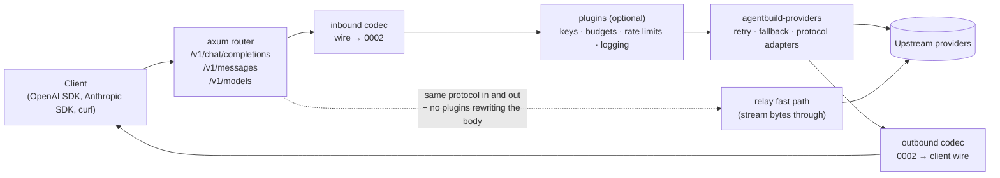

# 0006: Provider layer and embeddable gateway

Status: **Approved; foundation in progress.** Built so far in
`crates/agentbuild-providers`: the 0002 types, `ModelError` and the HTTP
error classifier (§6), the `Model` trait (§3), a `FakeModel` for tests, the
incremental SSE parser, the stream assembler (§5), the HTTP transport, the
`openai_chat` protocol with endpoint presets (§4) and `ProviderModel`. Next:
the agent loop (0004) on top of `Model`; then `anthropic_messages`.

`openai_chat` as built: `OpenAiQuirks` (`max_tokens_field`, `stream_usage`,
`parallel_tool_calls`, `reasoning_effort`, `system_role`, `reasoning_echo`);
presets `Endpoint::{openai, openrouter, ollama, lmstudio, vllm,
openai_compatible}`. Invalid tool calls are sent back as calls with their raw
arguments, so their error results stay paired. Images in tool results move
to a user message after the tool run. The non-streaming decoder converts the
response into `StreamItem`s and runs the same `Assembler` as streaming, so id
repair and argument parsing are identical in both modes. `ModelResponse`
carries `warnings` (encode drops plus decode repairs). `Model::stream(request,
on_delta)` has a default (one delta per text block from `invoke`).
`preview_request` shows the exact body without sending it.

A live check against a local Ollama found that its OpenAI endpoint answers an
unknown model with 404 and in-band type `api_error`; generic in-band types
(`api_error`, `server_error`) therefore no longer override the HTTP status.

Transport as built: `Transport` (reqwest 0.13, rustls with the OS trust
store via the platform verifier, HTTP/2, `HTTP(S)_PROXY`), behind the default
feature `http`. `send` returns a whole 2xx body; `open` returns a `Body`
read chunk by chunk. Timeouts: connect (10 s), first byte (defaults to the
total), idle between chunks (60 s), total (120 s). Dispatch: connection
failures (refused, DNS, TLS, connect timeout) are `not_sent`; failures after
sending are `sent`; failures while reading a 2xx body are `streaming`.
Non-2xx bodies (up to 64 KB) go through `classify_http`. Error messages are
built without the URL (it may carry a key) and redacted with the endpoint's
secrets. Tests use a scripted local TCP server, not `wiremock`, so they can
stall, trickle and cut responses at exact points.

Streaming as built: decoders produce `StreamItem`s (`Start`, `Delta{index,
BlockDelta}`, `BlockEnd`, `Usage`, `Finish`, `Warning`); `BlockDelta` also has
a `Block` form for blocks that arrive whole (redacted reasoning, provider
blocks). The `Assembler` returns each delta as a `MessageDelta` (the
`message_delta` event) and, at the end, the authoritative message plus
warnings. Tool-call arguments are parsed once, at block end or at finish;
an open tool call when the finish reason is `length` becomes an
`invalid_tool_call` with error `truncated`. `Usage` items replace earlier
values field by field when non-zero. The SSE parser is tested with 2,000
pseudo-random chunk cuttings (own xorshift, no `proptest` dependency).

`Model::invoke` borrows the request (`&ModelRequest`) instead of taking it
by value, so retries and fallbacks do not copy the transcript. `stream()`
will be added with a default implementation (one delta per block from
`invoke`), so existing implementations keep compiling.

Implements the provider contract of
[0002 §7](0002-messages-and-tools.md) and the error kinds of
[0003 §4](0003-error-model.md). It serves both products (architecture §1): the
**agent engine** calls it in-process, and the **gateway** exposes it over HTTP.
Research: [litellm-providers](../research/litellm-providers.md) (the full
blueprint and mapping tables are in its §10, referenced below),
[llmgateway](../research/llmgateway.md), [build-analysis](../research/build-analysis.md).

Decision context (user, 2026-10-11): learn from LiteLLM (MIT) and rebuild only
the light provider core in Rust. LiteLLM's own Rust crates are unpublished and
couple the provider core to cloud SDKs, secrets and a Python host (734 packages
in their lockfile). llmgateway is AGPL-3.0: studied at the architecture level
only, never ported.

---

## 1. Principles

1. **Our 0002 types are the only canonical shape.** Each wire protocol
   translates 0002 ⇄ wire directly. LiteLLM routes everything through
   OpenAI-chat shapes and loses block order, `strict`, server-tool semantics
   and citations as a result (research §2.5).
2. **Protocol ≠ provider.** A *protocol* is a wire format; an *endpoint* is
   data: base URL, auth, headers and quirk flags. One `openai_chat` protocol
   serves OpenAI, OpenRouter, Groq, Together, vLLM, LM Studio, Ollama,
   a LiteLLM proxy and any gateway.
3. **Decline, don't guess.** Anything a protocol cannot represent is either
   dropped with a `warning` event or rejected as `invalid_request` **before**
   the HTTP call. Never silently.
4. **Adapters classify; the core decides.** Adapters never retry, sleep or fall
   back. They return a classified `ModelError`. Retry and fallback are the
   0003 §5 policies, executed once in the core.
5. **Lossless for the same provider.** Unknown fields, signatures and
   server-tool blocks round-trip through `extras.<provider>` and `provider`
   blocks (LiteLLM's `extra`-map pattern, research §1.3).
6. **Light.** About 10 direct dependencies. No cloud SDKs, tokenizers or
   Python coupling. Each protocol is a Cargo feature.

## 2. Crates

```
agentbuild-providers   library: Model trait, protocols, transport, catalog   (modes 1–2)
agentbuild-gateway     HTTP server on top: axum router + standalone binary   (modes 3–4)
```

The agent engine depends only on `agentbuild-providers`. The gateway crate is
optional and adds axum. Module layout: research §10.2.

## 3. Core types (our own design; sketch in research §10.3)

- **`Model` trait**, the seam the agent runtime calls:
  `capabilities()`, `invoke(req) -> ModelResponse`, `stream(req) -> Stream<StreamItem>`.
  It is implemented by `ProviderModel` (protocol + endpoint + HTTP client) and by
  user models written in Python/TS (the escape hatch).
- **`Protocol` trait**: pure translation with no I/O, clock or environment.
  `encode`, `decode`, `stream_decoder`, `classify`.
- **`StreamDecoder`**: stateful SSE event → `StreamItem`s, with `finish()` at
  end of stream.
- **`Endpoint`**: `{protocol, base_url, auth, headers, quirks, capability_overrides}`
  plus presets.
- **`ModelError`**: `kind` (0003 §4), `status`, `provider_code`, `retry_after`,
  `request_id`, `dispatch` (`NotSent` | `Sent` | `Streaming{emitted_deltas}`),
  and a sanitized `message` (≤ 2 KB).

`dispatch` is LiteLLM's best error idea (research §4.1). `NotSent` (DNS, connect
refused) is always safe to retry or fall back immediately. `Sent` may already
have been billed.

## 4. Protocols and endpoints

| Order | Protocol | Covers |
|---|---|---|
| 1 | `openai_chat` | OpenAI, OpenRouter, Groq, Together, Fireworks, vLLM, LM Studio, Ollama (`/v1`), LiteLLM proxy, llmgateway, Vercel AI Gateway, any OpenAI-compatible server |
| 2 | `anthropic_messages` | Anthropic, natively: ordered blocks, thinking signatures, `cache_control`, hosted tools as `provider` blocks |
| later | `openai_responses` | OpenAI features that only exist there (§9 Q5) |
| later | `gemini`, Bedrock/Vertex hosts for Anthropic | behind features, driven by demand |

**Model strings.** `"<endpoint>:<model>"`, where the endpoint is a preset
(`openai`, `anthropic`, `openrouter`, `ollama`, `vllm`, `lmstudio`) or a name
the user registered:

```python
gw = Gateway(endpoints={
    "corp": OpenAICompatible(base_url="https://llm.corp.internal/v1", api_key_env="CORP_KEY"),
})
await gw.chat("corp:llama-4-70b", "hi")
```

No guessing the provider from the model name (LangChain does this,
[research](../research/langchain-agents.md) §4). An unknown endpoint prefix is an
`InvalidRequestError` listing the known endpoints.

**Mapping tables.** 0002 → OpenAI chat: research §10.5. 0002 → Anthropic
Messages: research §10.6. Both are normative for implementation. Each row
becomes a golden test case (§8).

## 5. Streaming

- Our own incremental **SSE parser** (~150 lines, WHATWG rules), tested with
  random chunk cuts (property tests).
- Decoders produce `Start`, `Delta{index, …}`, `BlockEnd`, `Usage`,
  `Finish`, `Warning`. The shared **assembler** builds the 0002 message and
  emits `message_delta` / `message_completed` (0002 §8). Tool-call arguments
  are parsed **once, at block end**. LangChain re-parses partial JSON on every
  chunk, which is quadratic ([research](../research/langchain-core.md)).
- **Unknown event types are ignored**, so new provider events don't break us.
  In-band `error` events are classified as `ModelError` with
  `dispatch=Streaming{emitted}`.
- A stream that ends without a terminal event is a `server` error, unless a
  finish reason was already seen.
- **Timeouts:** connect 10 s; first byte = per-attempt timeout; **idle
  between chunks 60 s** (LiteLLM has none, so stalled streams hang); total per
  attempt 120 s.
- A failed stream after deltas were emitted triggers `message_aborted` and a
  retry with a new message id (0003 §5.2). This is safe for us because tools
  only run after `message_completed`.

## 6. Errors, retries and fallback

The classification order and table are in research §10.8: transport failure,
then in-band code, then HTTP status, then message substrings (used only to refine a
400/413 into `context_overflow` or `content_filter`). Response headers are kept
so `Retry-After` / `retry-after-ms` are honored. LiteLLM's Rust layer drops them.

Retry and fallback live in the core (0003 §5.3), with these refinements from
the research:

- `dispatch=NotSent` errors: retry or fall back immediately, no backoff.
- `rate_limited` / `overloaded` with a fallback configured: move to the fallback
  without sleeping.
- `fallback_on` may include `context_overflow` (a larger-context model) and
  `content_filter` (another vendor), in addition to the 0003 defaults.
- An optional pre-call context check: if the catalog knows `max_input_tokens`
  and a cheap estimate exceeds it, raise `context_overflow` before sending
  (no cost incurred).
- **Not in the library:** cooldowns, load balancing, deployment health. These
  are gateway concerns (§7), and users can also point an endpoint at an
  external gateway that has them.

## 7. The gateway (`agentbuild-gateway`)

A thin HTTP layer around the same library. Modes 3 and 4 (architecture §1).



- **Inbound codecs** are the server-side mirror of each protocol: decode a
  client request into 0002 and encode the 0002 response into the client's wire
  format. A client can speak OpenAI while the upstream is Anthropic, and vice
  versa.
- **Relay fast path.** When the inbound and upstream protocols are the same
  and no plugin needs to rewrite the body, the gateway streams bytes through
  unchanged, observing usage from the stream as it passes. This is the main
  lever for low gateway overhead (LiteLLM's Rust layer relays for Anthropic,
  research §3.3).
- **Stateless by default.** Configuration comes from code (mode 3) or a YAML
  file (mode 4). Optional plugins, all off by default:
  - virtual API keys,
  - budgets and rate limits (in-memory, or Redis/Postgres plugins),
  - usage logging **off the critical path**: events go to a bounded queue and
    exporters drain it (idea from llmgateway, research §6),
  - sticky routing per session to keep provider prompt caches warm
    (llmgateway idea).
- **SSRF guard.** User-supplied URLs (image URLs, custom base URLs from
  clients) are validated against private address ranges unless allowed
  (llmgateway idea).
- **Targets, not claims:**
  - p50 added latency < 1 ms on the relay path and < 3 ms with translation;
  - memory < 50 MB idle.

  These are measured with a reproducible benchmark against the LiteLLM proxy
  before anything is published.

## 8. Testing (research §10.12)

1. **Golden translation tests**, one per mapping row (0002 ⇄ wire, both
   directions).
2. **Recorded SSE streams** replayed with random chunk cuts, compared with the
   non-streamed result.
3. **wiremock** for each error-classification row, both `Retry-After` forms,
   connect refused (`NotSent`), stalled stream (idle timeout), and streams
   without a terminal event.
4. **An error-body corpus** of real payloads from OpenAI, Anthropic, OpenRouter,
   vLLM, Ollama and llama.cpp.
5. **Live contract tests** (env-gated, nightly) against two gateways and Ollama.
   They assert invariants (valid transcript, parseable arguments, usage
   present), never exact text.
6. **Gateway compatibility:** the official OpenAI and Anthropic SDKs run against
   the gateway in CI.

## 9. Decisions on the research's open questions

| # | Question (research §10.13) | Decision |
|---|---|---|
| Q1 | New error kinds? | **Add `quota_exhausted`** (billing/quota; provider_fatal, never retried; a fallback to *another vendor* is allowed) and **`invalid_response`** (2xx with an unparseable body; not retried because it was already billed). 0003 §4 is updated |
| Q2 | Neutral reasoning setting? | **Yes:** `settings.reasoning = {effort: "low" \| "medium" \| "high"}` or `{budget_tokens: n}`, mapped per protocol; `extras.<provider>` overrides it |
| Q3 | System messages in the middle of an Anthropic conversation? | Leading system messages go to the top-level `system`. A later one becomes a user-turn text block prefixed `System note:`, with a `warning`. `strict_system=True` rejects it as `invalid_request` instead |
| Q4 | Usage semantics | `input_tokens` = all input processed **including** cache reads and writes; `cache_*_tokens` are subsets. 0002 §1 is updated |
| Q5 | OpenAI Responses API in v1? | **No.** It's the first protocol after the two v1 protocols, because new OpenAI features land there |

## 10. Model catalog

- **Source:** LiteLLM's `model_prices_and_context_window.json` (MIT, Copyright
  (c) 2023 Berri AI): 4,040 models across 139 providers.
- **What we ship:** a generated **subset** (tens of KB) for the providers we
  support. It contains limits, prices, and capabilities as **tri-state**
  values: `true` / `false` / absent = *unknown*. A missing flag does not mean
  "unsupported" (research §6.1). A `THIRD_PARTY_NOTICES` entry is added when
  the data is first used.
- **Capability resolution:** user override > endpoint preset override >
  protocol base capabilities combined with the exact catalog entry > a
  conservative default. **No name-pattern guessing.** For an unknown
  capability we attempt the feature and let the provider's
  `invalid_request` decide.
- **Uses:** default `max_tokens` for Anthropic, the pre-call context check,
  choosing the structured-output strategy (0004 §6), and cost in usage
  metadata.
- **Fresher data:** users can load a newer LiteLLM JSON at runtime
  (`Catalog::from_litellm_json`) without waiting for a release.

## 11. Implementation order

1. Foundation: `ModelError` + classifier, transport (timeouts, dispatch
   tracking, Retry-After), SSE parser, assembler. Tested with synthetic streams.
2. `openai_chat` with presets: covers gateways and local models.
3. `anthropic_messages`, native.
4. Structured output, images and files, catalog subset, capability resolution.
5. Python/TS `Gateway` bindings (mode 2).
6. `agentbuild-gateway`: router, inbound codecs, relay path, YAML config,
   benchmark vs LiteLLM proxy (modes 3–4).
7. Plugins (keys, budgets, logging, sticky routing), then `openai_responses`
   and Gemini.
