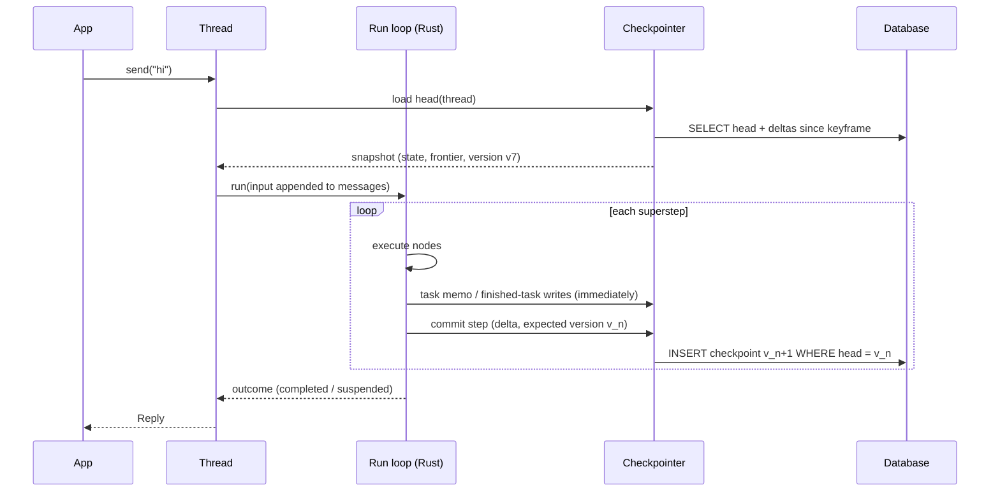

# 0008: Persistence, threads and memory

Status: **Accepted**; §10 steps 1–4 built (§11–§14); step 5 (retention, encryption at rest) built (§15); step 6 (semantic memory search) built (§16); `thread.stream` built (§17); workflow threads built (§18). Builds on [0005](0005-core-runtime-extensions.md)
§5 (snapshots, saved task writes, resume) and gives developers the easy
interactive API sketched in [0007](0007-public-api.md). Research input:
[langgraph](../research/langgraph.md) §5 (checkpointing), §6 (interrupts) and §8 (store).

## Goals

1. **One parameter turns it on.** `storage="sqlite://agent.db"` gives
   conversations, crash recovery, approval/resume, history and long-term memory.
   No extra setup code.
2. **Interactive by default.** Chatting, approving, rewinding and inspecting are
   short method calls on a `Thread` object.
3. **Same data from Python and TypeScript.** Everything stored is plain JSON
   (0005 §5.2). A thread started in Python can be continued in TypeScript.
4. **Cheap at scale.** Storage grows with *new* data, not with history length.
   LangGraph rewrites a whole changed channel each step, which is O(n²) for long
   chats ([research](../research/langgraph.md) §5.2, §10).
5. **Correct under crashes and concurrency.** Clear guarantees, documented
   limits, no silent forks.

---

## 1. Concepts

| Concept | What it is | Lifetime |
|---|---|---|
| **Thread** | One conversation or work item: a sequence of runs sharing state | Until deleted or expired |
| **Checkpoint** | Durable record of a committed step (0005 §5) | Per retention policy |
| **Short-term memory** | The thread's state, including `messages` | Lives in checkpoints |
| **Long-term memory** | Facts that outlive a thread (user preferences, learned info), in a namespaced **memory store** | Until deleted or its TTL ends |
| **Storage** | One object holding a checkpointer and a memory store, usually the same database | App lifetime |

## 2. The developer API

### 2.1 Turning it on

```python
agent = Agent(model=…, tools=[…], storage="sqlite://agent.db")       # file, zero setup
agent = Agent(model=…, tools=[…], storage="postgres://user@host/db")  # production
agent = Agent(model=…, tools=[…])                                      # in-memory (lost on exit)
```

```ts
const agent = new Agent({ model, tools, storage: "sqlite://./agent.db" });
```

Workflows take the same parameter: `wf.compile(storage=...)`. Tables are
created automatically on first use (§6.4).

### 2.2 Threads: the interactive surface

```python
chat = agent.thread("user-42")                 # created on first use

reply = await chat.send("My order A-1001 arrived broken")
print(reply.text)

reply = await chat.send("Can you refund it?")  # remembers the conversation
if reply.needs_approval:                       # human-in-the-loop (0004 §7)
    for req in reply.approvals:
        print(req.tool, req.args, req.description)
    reply = await chat.approve()               # approve all pending
    # or: await chat.reject("Too expensive"), chat.edit(req.id, args={...}),
    #     chat.respond(req.id, "Customer already refunded")

async for event in chat.stream("Anything else?"):     # streaming send
    if event.type == "message_delta":
        print(event.text, end="")
```

| Method | Does |
|---|---|
| `send(input)` / `stream(input)` | Run one turn on the thread; returns `Reply` / streams events |
| `approve()`, `reject(msg?)`, `edit(id, args)`, `respond(id, msg)` | Answer pending approvals, then continue automatically |
| `resume(values)` | Generic resume for custom `Suspend` payloads (workflows) |
| `cancel()` | Cancel the active run on this thread |
| `state()` | Current state (messages, output, custom keys) |
| `history(limit=)` | Checkpoints, newest first: step, time, source, summary |
| `rewind(checkpoint_id)` | Make an older checkpoint the head (keeps the newer branch, §5.3) |
| `fork(checkpoint_id, new_thread=)` | Copy history up to a checkpoint into a new thread |
| `update(values)` | Edit state by hand (recorded as a `manual` checkpoint, §5.4) |
| `delete()` | Delete the thread and its checkpoints |

`Reply` fields: `text`, `output`, `status` (`completed` | `suspended`),
`needs_approval`, `approvals`, `usage`, `stop_reason`, `checkpoint_id`.

The same methods exist in TypeScript (`chat.send`, `chat.approve`, …), with
`AbortSignal` support on `send` and `stream`.

**Pending approvals survive restarts.** A process can die after `send` returns
`needs_approval`. Another process calls `agent.thread("user-42").approve()`
and continues from the stored snapshot.

### 2.3 Long-term memory

```python
from criogenai import Memory

agent = Agent(
    model=…, tools=[…], storage="postgres://…",
    memory=Memory(
        namespace=lambda ctx: ("users", ctx.context.user_id),   # per-user memory
        recall=5,                     # inject up to 5 relevant memories before each model call
        tools=True,                   # give the model `remember` / `forget` tools
        embed="openai:text-embedding-…",   # optional: semantic search; else keyword
    ),
)
```

Direct access from app code, tools and hooks:

```python
mem = agent.storage.memory
await mem.put(("users", "42"), "diet", {"value": "vegetarian"}, ttl="90d")
item = await mem.get(("users", "42"), "diet")
hits = await mem.search(("users", "42"), query="food preferences", limit=5)
await mem.delete(("users", "42"), "diet")
```

Inside a tool: `ctx.memory` (same API, already scoped to the agent's namespace).

---

## 3. How it fits the runtime



## 4. Storage format

### 4.1 Delta checkpoints with keyframes

Each committed step stores **only what changed**, as reducer operations
(0005 §3): "append these 2 messages", "set `category`". Reducers are
deterministic and run in Rust, so replaying deltas rebuilds the state exactly.

- A **keyframe** (full state) is written every N checkpoints (default 25), and
  whenever the delta chain since the last keyframe exceeds the state's size.
- Loading a thread = the latest keyframe + the deltas after it. That's a
  bounded amount of work.
- A 500-turn chat stores each message **once**, plus occasional keyframes. Not
  500 copies of a growing list.

### 4.2 Tables (SQL backends)

```
threads(thread_id PK, created_at, updated_at, head_checkpoint_id, head_version,
        metadata JSON, expires_at)
checkpoints(checkpoint_id PK (UUIDv7), thread_id, parent_id, version, step,
        source ENUM(input, step, suspend, failure, manual, fork),
        kind ENUM(delta, keyframe), body JSON (delta ops or full snapshot),
        frontier JSON, join_progress JSON, suspended JSON, workflow_fingerprint,
        created_at)
pending_writes(checkpoint_id, task_id, key, value JSON, created_at)   -- task memo + finished-task output
memory(namespace TEXT, key TEXT, value JSON, created_at, updated_at, expires_at,
        embedding VECTOR NULL, PRIMARY KEY(namespace, key))
schema_migrations(version, applied_at)
```

Namespaces are stored as a joined path (`users/42`) so prefix search is an
index range scan. JSON is the only value format: **no pickle**, no
language-specific class names (LangGraph's msgpack embeds Python class paths,
[research](../research/langgraph.md) §5.6).

### 4.3 Backends

| Backend | URL | Use | Vector search |
|---|---|---|---|
| In-memory | (default) | Tests, scripts | brute force |
| SQLite | `sqlite://path.db` | Local apps, single process, edge | `sqlite-vec` (optional feature) |
| Postgres | `postgres://…` | Production, multi-process | `pgvector` (optional feature) |
| Custom | `Storage(checkpointer=…, memory=…)` | Anything else | implementer's choice |

All built-in backends are implemented **once in Rust** (async, `sqlx`), so
Python and TypeScript share the same code, behaviour and on-disk format. Custom
backends implement two small interfaces (§7), in Rust or in the SDK language.
Redis/Valkey and DynamoDB are later candidates, driven by demand.

---

## 5. Guarantees and semantics

### 5.1 Durability modes

| Mode | Behaviour | Default for |
|---|---|---|
| `step` | Each step's checkpoint is written **before** the next step starts | **default** |
| `async` | Checkpoint writes overlap the next step; a crash may lose the last step (the run resumes from the previous one) | high-throughput workflows |
| `exit` | Only the final, suspended or failed state is written | short runs where only results matter |

Task memo writes (finished tool calls, 0005 §1) are always written immediately
in `step` mode. That is what lets a resumed run skip tools that already ran.

### 5.2 Concurrency on a thread

Each thread has a **head version**. A commit succeeds only if the head is still
the version the run started from (compare-and-set). A second run on a busy
thread therefore cannot silently fork it:

| `on_busy` | Second `send` while a run is active |
|---|---|
| `"wait"` (default) | Waits for the active run to finish, then runs (queued, FIFO). Waits at most `busy_timeout` (default 60 s), then `ThreadBusyError` |
| `"reject"` | Fails fast with `ThreadBusyError` (`thread_busy`) |
| `"interrupt"` | Cancels the active run (outcome `cancelled`), then runs |

Across processes, the same compare-and-set keeps it correct. `wait` uses an
advisory lock on Postgres, an in-process queue plus head-version polling with
backoff on SQLite, and a plain queue in memory. (As built, §14: Postgres
locks across processes, including `reject` and `interrupt`; SQLite's
polling is not built yet.) Queuing is the default because
chat UIs expect a second message to wait its turn, not to fail.

### 5.3 History, rewind and fork

- Checkpoints form a tree via `parent_id`. `rewind(id)` moves the thread head
  to an older checkpoint with source `fork`. The abandoned branch stays in
  `history(all_branches=True)` until pruned.
- Resuming from an old checkpoint **re-runs** the next steps; it does not replay
  recorded results. Use it to retry with a different input or after editing
  state. (LangGraph behaves the same, [research](../research/langgraph.md) §5.5.)

### 5.4 Manual edits

`thread.update(values)` applies `values` through the normal reducers and writes
a `manual` checkpoint. The frontier is left unchanged. A pending approval stays
pending, and the next `send` or `resume` sees the edited state. This
replaces LangGraph's `as_node` mechanism, which re-runs a node's writers and has
special `INPUT`/`END`/`__copy__` cases ([research](../research/langgraph.md) §5.5).

### 5.5 Crash recovery

On restart, a thread whose head checkpoint has a non-empty frontier and no
outcome was interrupted mid-run (status `in_progress`). `thread.retry()`
re-runs the interrupted step: finished tasks reuse their saved output,
unfinished ones run again with their memo. `send` on such a thread fails
with `thread_interrupted` instead of starting a new turn on top of an
unfinished one (strict now; an automatic `recover` on `send` can be added
later without breaking anyone, rule 4).

**Honest limit.** If the process dies *after* a tool's side effect but
*before* its memo is written, the tool runs again on recovery. For tools where
that matters, `ctx.idempotency_key` gives a deterministic key
(hash of run, step, task and `call_id`) to pass to external APIs that support
idempotency keys (payments, email providers), or to check in your own database.

---

## 6. Operations

### 6.1 Retention

`storage.retention(keep_checkpoints=50, keep_branches=False, thread_ttl="30d")`
prunes old checkpoints, never deleting the latest keyframe chain. Expired
threads and memory items are removed by a background sweep, or by calling
`storage.prune()` (for serverless deployments). As built: §15.1.

### 6.2 Privacy

- `thread.delete()` and `memory.delete_namespace(ns)` remove all rows for the
  thread or namespace, including pending writes and embeddings.
- **Run context is never stored.** `context=` holds runtime dependencies (DB
  clients, credentials) and is not part of state.
- Optional encryption at rest:
  `Storage(…, encrypt=Key.from_env("CRIOGEN_KEY"))` encrypts `body`,
  `value` and pending writes (AES-GCM, key id stored per row for rotation).
  As built: §15.2 (also snapshots and memory keys).

### 6.3 Schema evolution

- The **workflow fingerprint** (0005 §5.2) is stored per checkpoint. Loading a
  thread whose fingerprint differs from the current agent or workflow follows
  `on_mismatch`:
  - `"error"` (default): `WorkflowMismatchError`;
  - `"migrate"`: run user-registered migration functions for state keys, then
    continue;
  - `"continue"`: accept the risk.
- Agents get a stable fingerprint: changing tools or instructions does **not**
  change it; changing the graph shape does.

### 6.4 Database migrations

Built-in backends version their tables (`schema_migrations`). The default is to
migrate automatically on first use. `storage.migrate(dry_run=True)` and the CLI
`criogenai storage migrate` exist for teams that run migrations in CI.

---

## 7. Extension interfaces

```rust
trait Checkpointer: Send + Sync {
    async fn load(&self, thread: &ThreadId, at: Option<CheckpointId>) -> Result<Option<Snapshot>>;
    async fn commit(&self, thread: &ThreadId, expected: Version, cp: CheckpointRecord) -> Result<Version>; // CAS
    async fn put_pending(&self, cp: &CheckpointId, task: &TaskId, key: &str, value: Value) -> Result<()>;
    async fn history(&self, thread: &ThreadId, q: HistoryQuery) -> Result<Vec<CheckpointMeta>>;
    async fn delete_thread(&self, thread: &ThreadId) -> Result<()>;
}

trait MemoryStore: Send + Sync {
    async fn put(&self, ns: &Namespace, key: &str, value: Value, ttl: Option<Duration>) -> Result<()>;
    async fn get(&self, ns: &Namespace, key: &str) -> Result<Option<Item>>;
    async fn search(&self, ns_prefix: &Namespace, q: SearchQuery) -> Result<Vec<Item>>;
    async fn delete(&self, ns: &Namespace, key: &str) -> Result<()>;
}
```

Five checkpointer methods and four store methods. LangGraph's saver has
about 12 methods with sync and async twins
([research](../research/langgraph.md) §5.2). Backends receive whole
checkpoints. A custom backend may store them as they are; the built-in SQL
backends encode deltas and keyframes internally with the public
`criogenai_storage::delta` helpers (as built: §12). Encryption is
inside the SQL backends, after encoding (deltas need the plain state);
retention adds two methods (§15.1). Python and TS can implement the
same interfaces (async methods); the bridge adapts them.

## 8. Errors (added to 0003 §9)

| Code | Category | When |
|---|---|---|
| `thread_busy` | policy | Another run holds the thread and `on_busy="reject"`, or `busy_timeout` elapsed with `on_busy="wait"` |
| `storage_unavailable` | transient | Database connection or timeout failure; retried per policy, then fails |
| `storage_conflict` | developer | Compare-and-set lost for a reason other than `thread_busy` (e.g. external edit) |
| `checkpoint_not_found` | developer | `rewind`/`fork` to an unknown id |
| `workflow_mismatch` | developer | §6.3 |
| `storage_corrupt` | internal | A delta chain cannot be replayed, or a row cannot be decoded |
| `storage_incompatible` | developer | The database schema is newer than this version supports |
| `thread_suspended` | developer | `send` on a thread that waits for approval: answer it first (`approve`, `reject`, `decide`) |
| `thread_interrupted` | developer | `send` on a thread whose last run did not finish: continue it with `retry` first (§5.5) |
| `storage_failed` | transient | (core run error) the run's progress could not be saved during the run; the cause's storage code is in the message and `NodeError` kind |
| `invalid_value` | developer | A memory item the store does not accept: root namespace, bad key, value over 1 MiB (P11, §13); text Postgres cannot store, e.g. a NUL character (§14); a malformed encryption key (§15.2) |
| `encryption_key_missing` | developer | Encrypted data but no key for it: an encrypted database opened without keys, a row whose key id is not in the keyring (§15.3) |
| `encryption_key_invalid` | developer | A key whose id the database knows does not match it (§15.3) |

A storage failure **during** a run fails the step (nothing committed) and the
run reports the error with its in-memory snapshot attached, so no work is lost
even if the database was down.

## 9. Edge cases

| # | Case | Behaviour |
|---|---|---|
| P1 | Two browser tabs call `send` on the same thread | Second waits its turn (default) and then runs on the updated state; `on_busy="reject"` fails it instead |
| P2 | Process killed while waiting for approval | Nothing lost: the suspension was committed; any process can `approve()` later |
| P3 | Process killed mid-tool-call | `recover()` re-runs the step; finished calls are skipped; the in-flight call runs again (§5.5 idempotency key) |
| P4 | Approve twice (double click) | The first `approve()` consumes the suspension; the second gets `ResumeError` ("nothing pending") |
| P5 | Database down at `send` | `storage_unavailable` before any model call (no cost incurred) |
| P6 | Database fails at step commit | Step not committed; `RunError` carries the in-memory snapshot to retry later |
| P7 | Thread created in Python, continued in TS | Works: JSON format, same fingerprint rules |
| P8 | 10,000-message thread | Load = keyframe + ≤ 25 deltas; per-step writes stay proportional to new messages |
| P9 | Agent deployed with a new tool while threads are suspended | Fingerprint unchanged (tools excluded); pending calls are re-validated against current tools on resume (0004 A9) |
| P10 | Memory search with no embedding model configured | Keyword search (SQLite FTS5 / Postgres full-text); `warning` once |
| P11 | `memory` item too large (> 1 MB default) | `invalid_value`; long content belongs in files or blobs, not memory |
| P12 | Clock skew between processes | Ordering uses UUIDv7 plus versions, never wall-clock comparisons |

## 10. Implementation order

1. In-memory checkpointer + `Thread` API (`send`, `approve`, `history`) on top
   of 0005 snapshots.
2. SQLite backend (delta + keyframe format, compare-and-set, migrations).
3. Memory store (keyword search) + agent `Memory` hook and tools.
4. Postgres backend, `on_busy="wait"` across processes.
5. Retention, encryption at rest (built: §15).
6. Semantic memory search (built: §16; vector indexes later).

## 11. Step 1 as built

Crate `criogenai-storage` (depends on `criogenai-core` only) holds the
storage contract and the in-memory backend; `criogenai-agent` adds the
`Thread` API on top. SQL backends will be features of the storage crate.

**Checkpoints.** A `Checkpoint` is plain JSON: `id` (UUIDv7), `thread_id`,
`parent_id`, `version` (1, 2, 3… per thread), `source`, `run_id`, `step`,
`state`, and `snapshot` when the run is resumable (suspended or failed).
Its status follows from the snapshot: `suspended` if it has suspended nodes,
`failed` if it carries an error, otherwise `completed`.

**Checkpointer.** Four methods, all returning boxed futures so the trait
works behind `Arc<dyn Checkpointer>`:

| Method | Contract |
|---|---|
| `load(thread, at)` | The head (`at = None`) or one checkpoint of that thread; `None` if missing |
| `commit(checkpoint, expected)` | Compare-and-set: succeeds only if the head version is `expected` (0 for a new thread) and `checkpoint.version == expected + 1`; the checkpoint becomes the head. Otherwise `storage_conflict` |
| `history(thread, limit)` | The head's branch, newest first, as `CheckpointMeta` (no state) |
| `delete_thread(thread)` | Removes the thread and all its checkpoints; `true` if it existed |

`put_pending` (§7) arrived with per-step commits in step 2 (§12).

**Durability in step 1 is `exit`** (§5.1): one checkpoint per call, written
when the run completes, suspends or fails. The in-memory backend cannot
survive a crash anyway; per-step commits and crash recovery come with
SQLite.

**Storage and busy threads.** `Storage` bundles a checkpointer with the
`on_busy` policy (`Wait` default, `Reject`, `Interrupt`) and `busy_timeout`
(60 s). Each thread operation holds a process-local lease for the thread;
`Interrupt` cancels the active run first. The lease table drops a thread's
entry when no one holds or waits for it. Compare-and-set still catches
writers in other processes.

**Agent threads.** Every agent has a `Storage` (default: a fresh in-memory
one; `AgentBuilder::storage` shares one). `agent.thread(id)` returns a
`Thread`:

| Method | Does |
|---|---|
| `send(input)`, `send_with(input, options)` | Starts from the head state, appends the input messages, runs, commits. Per-run bookkeeping (`agent`, `hooks` keys) is reset; other keys carry over. Fails with `thread_suspended` while approvals are pending |
| `approve()`, `reject(msg)` | One decision for every pending request |
| `decide(decisions)`, `decide_with` | One `Decision` per `call_id` (edit, respond, mixed) |
| `retry()` | Continues a failed head from its snapshot (finished tool calls are not run again) |
| `cancel()` | Cancels this thread's active run in this process |
| `state()`, `messages()`, `head()`, `pending_approvals()` | Read the head |
| `history(limit)` | Checkpoints of the current branch, newest first |
| `rewind(checkpoint_id)` | New head (source `fork`) copying an older checkpoint |
| `delete()` | Deletes the thread |

`send` and `decide` return a `Reply`: the `AgentResult` plus the new
checkpoint's id and version. A failed run is committed as a `failure`
checkpoint (so `retry` works later) and its `AgentError` is returned. An
error before the run starts (hook failure, invalid decisions) commits
nothing. If the commit itself fails, the storage error is returned with the
run's error attached when there was one.

`send_with` keeps a caller's cancel token: the thread runs on a child of it,
so both `thread.cancel()` and the caller's token stop the run.

Not in step 1: workflow threads (`resume(values)`), `stream`, `update`,
`fork`, `on_mismatch`, retention, encryption, the memory store.

## 12. Step 2 as built

Durability `step` (§5.1), crash recovery (§5.5) and the SQLite backend
(§4). Not yet: durability `async`, history across branches, `fork`,
`update`, `on_mismatch`, retention, encryption (later steps).

**Core: `Persister`.** `criogenai-core` gained one trait so the engine can
save a run while it executes without knowing about storage.
`RunOptions::persist(Arc<dyn Persister>)` turns it on:

| Method | Called |
|---|---|
| `save_checkpoint(snapshot)` | Before the first step of every `run`, `resume` and `retry` (resume values and saved work in `pending_writes`), and after each committed step the run continues from. Not for the final outcome: the caller saves that |
| `save_task(step, node, write)` | When a node finishes (its output), and for every `TaskMemo::save` entry, before the run goes on |

Every call is awaited. An error stops the run with the new run error
`storage_failed`; its snapshot keeps everything done so far, so nothing is
lost while the database is down (P5, P6). `TaskMemo::save(key, value)` is
`put` plus the write-through (and `once` uses it); a failed save returns a
`NodeError` of kind `storage_failed` so the node stops doing side effects.
The agent's tools node saves each finished call this way. If storage fails
it finishes the step's calls, then fails the run before the next model call,
with every result in the snapshot.

**Checkpoint status `in_progress`.** A checkpoint whose snapshot has no
suspended nodes and no error is a point a run continues from. After a
crash, the head stays `in_progress`.

**`Checkpointer::put_pending(thread, checkpoint, node, write)`.** The fifth
method (§7). It merges a task write into that checkpoint's
`pending_writes[node]` (`merge_pending`: memo entries added, `output` and
`resume` replaced). Every later `load` returns the merged snapshot. Only
checkpoints with a snapshot accept writes (`checkpoint_not_found`
otherwise).

**`ThreadWriter`** (in `criogenai-storage`) is the `Persister` for one
thread. It holds the head it last wrote: the first checkpoint of a call is
source `input`, later ones `step`, each with `expected` = the previous
version (compare-and-set). Task writes go to its latest checkpoint.
`commit` then saves the outcome (`step`, `suspend` or `failure`). Custom
code (workflow threads, SDK bridges) uses the same writer.

**`Durability`** on `Storage`: `Step` (default, for every backend so
behaviour does not depend on the backend) or `Exit` (one checkpoint per
call, as in step 1). A simple chat turn writes two checkpoints (`input`,
final). A turn with one tool call writes four: `input`, after the model,
after the tools, final.

**Threads.** `send` fails with `thread_interrupted` on an `in_progress`
head; `retry` continues a `failed` or `in_progress` head. Finished tool
calls are not repeated, including calls finished just before a crash. A
call interrupted mid-flight runs again (§5.5's honest limit).

**Deltas** (`criogenai_storage::delta`, public so custom backends can
reuse it). `diff(old, new)` gives `set`, `append` (a list that only grew:
just the new elements) and `remove` operations, in key order; `apply`
replays them (`storage_corrupt` if an append hits a non-list). It works on
plain state, so it needs no reducers and stays correct for any reducer.

**SQLite** (feature `sqlite` of `criogenai-storage`, forwarded by
`criogenai-agent`; `sqlx` 0.8 without macros, SQLite bundled).
`SqliteCheckpointer::connect(url)` / `open(path)`, or
`Storage::connect("sqlite://file.db")` (`"memory:"` and `sqlite::memory:`
also work). WAL journal, 5 s busy timeout, up to 8 connections (one for
in-memory).

- Tables, prefixed `criogen_` so they can live in an app's database:
  `threads(thread_id, head_id, head_version, created_at_ms, updated_at_ms)`,
  `checkpoints(id, thread_id, parent_id, version, source, status, run_id,
  step, kind, depth, body, snapshot, created_at_ms)`,
  `pending_writes(seq, checkpoint_id, node, write, created_at_ms)`,
  `schema_migrations(version, applied_at_ms)`.
- **Encoding.** `kind` is `keyframe` (body = full state) or `delta` (body =
  operations against the parent). A delta is written when the parent is
  fewer than `keyframe_interval` (default 25) deltas from its keyframe
  *and* the delta is smaller than the state. `depth` counts deltas since
  the keyframe. Loading walks the parent chain back to the keyframe in
  one recursive query and replays. The snapshot is stored without its
  state when it equals the checkpoint's (it always does for threads).
  The writer caches the last state per thread (up to 256 threads), so a
  commit does not read its parent back.
- **Compare-and-set.** One `BEGIN IMMEDIATE` transaction: a conditional
  `UPDATE threads … WHERE head_version = expected` (or an insert for a new
  thread) must change exactly one row, then the checkpoint row is
  inserted. Two handles on one file cannot fork a thread (tested); leases
  stay per process.
- **Migrations** run automatically on connect, in one transaction, and are
  recorded. A database at a newer schema version is refused with
  `storage_incompatible`.
- **Errors.** Connection, I/O, busy and closed-pool errors are
  `storage_unavailable`; undecodable rows are `storage_corrupt`.

`history`, `delete_thread` and `put_pending` are single queries (recursive
CTE along `parent_id`; three deletes in one transaction; `INSERT … SELECT …
WHERE EXISTS`). Measured in the tests: a 40-turn chat with a keyframe every
10 checkpoints stores each message about once per delta plus four
keyframes, under a third of what full copies would need. That is a test
assertion, not a benchmark.

## 13. Step 3 as built

Long-term memory (§2.3): a memory store in `criogenai-storage`, and
`Memory` for agents in `criogenai-agent`. Not yet: vector search, a
background sweep of expired items, encryption (step 5).

**Namespaces.** `Namespace` is a list of segments (`["users", "42"]`,
written `users/42`). Segments are non-empty, without `/` or control
characters (`invalid_value` otherwise). The root (no segments) holds no
items; it is the prefix of every namespace. `contains` is a segment-wise
prefix test, so `users/ada` does not contain `users/adam`.

**`MemoryStore`.** Six methods (§7's four plus two for privacy and
retention):

| Method | Contract |
|---|---|
| `put(ns, key, value, ttl)` | Insert or replace. `created_at` is kept on replace (reset when the old item had expired). `ttl = None` keeps it until deleted. Refuses the root, keys outside 1–256 bytes and values over 1 MiB of JSON (`invalid_value`, P11) |
| `get(ns, key)` | The item, unless missing or expired |
| `search(prefix, query)` | Live items in `prefix` and below, ranked (below); `limit` default 10 |
| `delete(ns, key)` | `true` if a live item was removed |
| `delete_namespace(prefix)` | Everything in `prefix` and below (§6.2: everything about one user or patient); returns the count; refuses the root |
| `prune_expired()` | Removes expired items (expired items are already invisible) |

`ScopedMemory` is a store plus one namespace (what tools see). `Storage`
holds a memory store next to the checkpointer (`storage.memory()`;
in-memory by default, `with_memory` to replace); `Storage::connect` with a
SQLite URL puts both in the same database.

**Keyword search, the same on every backend.** An item's words are its key
and the strings and numbers in its value (not field names), lower-cased,
split on anything that is not a letter or digit (any script). A query's
words are the same minus common English stop words ("what", "is", "my",
…), at most 32. Each query word scores 1 if it is one of the item's
words, 0.5 if it starts one (query words of three letters or more), and
the item's score is the mean. Only items scoring above 0 are returned,
best first, then newest, then namespace path and key in byte order. A
query without words (none given, or only stop words) returns the newest
items. Every backend ranks in Rust with the same function, so results do
not depend on the backend; SQLite only narrows the rows first (below).
P10's FTS5 / full-text indexes are deferred until a benchmark shows the
need: per-user memory is usually small.

**SQLite** (`SqliteMemoryStore`, from `SqliteCheckpointer::memory_store`
or `SqliteMemoryStore::connect`). Migration 2 adds
`criogen_memory(namespace, key, value, search_text, created_at_ms,
updated_at_ms, expires_at_ms, PRIMARY KEY (namespace, key))` and an index
on `expires_at_ms`. `search_text` stores the words as ` w1 w2 … `; a
search selects the live rows in the prefix that contain ` <word>` for any
query word (`instr`), then ranks them. Without words it orders and limits
in SQL. A version-1 database is upgraded on connect.

**Agents: `Memory`.** `AgentBuilder::memory(Memory)` uses the agent
storage's memory store. Each run works in one namespace:

| Scope | Namespace |
|---|---|
| `Memory::by_state(key, prefix)` | `prefix/<state[key]>` (a string or number) |
| `Memory::shared(ns)` | `ns` for every run |
| `Memory::resolve(rule)` | `rule(&state)` |

A run whose scope cannot be resolved (missing key, a value that is not a
string or number, an invalid segment, or the rule's `Err`) fails with
`invalid_state` before the model is called. It never falls back to a
shared namespace, so one person's facts cannot reach another's run.

The scope comes from the run's state, so `AgentInput` gained values:
`AgentInput::from("hi").with("user_id", "42")` sets state keys for the
run. In a thread they are written into the thread's state and carry over
to later turns. The agent's own keys (`messages`, `agent`, `hooks`) are
refused with the new code `invalid_input`.

- **Recall.** Before each model call the model node searches the run's
  namespace with the text of the latest user message, takes up to
  `recall` items (default 5), fills the remaining places with the newest
  items, and adds them to the request as a system message (id
  `msg_memory`) after the instructions. It is not stored in the
  transcript. It tells the model the facts may be out of date and are
  information, not instructions. A `memory_recalled` event carries the
  namespace and the keys, never the values (they may be personal data).
  `recall(0)` turns it off. (§16 adds `"search"`: `keyword` or
  `semantic`.)
- **Tools** (default on; `tools(false)` turns them off): `remember(key,
  value)` (idempotent; the value is stored as a JSON string, with the
  optional `Memory::ttl`), `forget(key)` (idempotent, destructive) and
  `search_memory(query, limit ≤ 20)` (read-only; returns
  `[{key, value}]`). Their names are reserved like any tool name: an app
  tool with the same name fails the build. Bad keys or values become tool
  errors the model can fix; an unreachable store is a retryable tool
  error. Approval rules apply to them like to any tool.
- **`ToolContext::memory()`** gives any tool the run's `ScopedMemory`
  (`None` without `Memory`).

The fingerprint does not change: the memory tools are tools, and recall
is part of the model node.

## 14. Step 4 as built

Postgres: feature `postgres` of `criogenai-storage` (forwarded by
`criogenai-agent`), with `PostgresCheckpointer`, `PostgresMemoryStore`
and `PostgresThreadLocks`. `Storage::connect("postgres://…")` (or
`postgresql://`) sets up all three on one database. Tested on
PostgreSQL 13 and 18.

**Same format, same behaviour as SQLite.** Same tables, columns and
migration versions (§12, §13), with `BIGINT` integers and JSON as `TEXT`
(as written; `jsonb` would refuse `\u0000` inside strings). The
encoding is one module both backends call: deltas with keyframes,
snapshots without a second copy of the state, the per-thread state
cache. Only the SQL differs. The checkpointer and memory-store contract
tests that run on SQLite also run on Postgres. Memory namespaces and keys
are `COLLATE "C"`: byte order, as in SQLite, so ties sort the same, and
a namespace prefix `p` is the index range [`p/`, `p0`) (`0` is the byte
after `/`).

**Compare-and-set** is unchanged: `UPDATE … WHERE head_version =
expected` (or `INSERT … ON CONFLICT DO NOTHING` for a new thread), in the
transaction that inserts the checkpoint. Under read committed, a
concurrent writer's update waits for the first transaction, then sees
the new version, changes no row, and fails with `storage_conflict`.
Tested with 9 writers in 3 processes (90 commits, one linear branch).

**Migrations** run on connect, in one transaction holding
`pg_advisory_xact_lock`. Processes that start together wait for the
first, which migrates; the rest find nothing to do (tested with four at
once).

**Thread locks across processes (§5.2).** A new trait in
`criogenai-storage`:

```rust
trait ThreadLocks {
    fn lock(&self, thread, wait: Option<Duration>, on_interrupt) -> Option<HeldLock>; // None: busy
    fn interrupt(&self, thread);
}
```

`Storage::lease` takes the lease in this process first (FIFO in the
process, as before). Then, if the storage has `ThreadLocks`, it takes the
thread's lock. One `busy_timeout` covers both waits. Dropping the lease
releases the lock first, then the local lease.

| `on_busy` | Across processes |
|---|---|
| `Wait` | Waits for the lock (Postgres's lock queue, so in arrival order) until `busy_timeout`, then `thread_busy` |
| `Reject` | Tries once; `thread_busy` ("another process runs it") |
| `Interrupt` | Tries once. If the lock is held, sends an interrupt, then waits as `Wait`. The holder's process cancels its run (the token from `ThreadLease::set_cancel`) |

An interrupt that arrives before the holder registers its token is kept: the
token is cancelled as it is registered. `ThreadLease::interrupted()` reports
either case, so work done between taking the lease and registering can stop
early. The flag belongs to that lease only; the next holder starts clean.

Postgres uses **session advisory locks**. The key is
`hashtextextended('criogen/thread/' || thread_id, 0)`, computed by the
server so every client agrees on it. One task owns each lock's
connection from start to end:

1. It takes the lock: `pg_try_advisory_lock`, or `pg_advisory_lock` with
   `lock_timeout` set to the time left. The server ends the wait, so the
   connection is never dropped mid-query.
2. It runs `LISTEN criogen_interrupt` (before taking the lock, so an
   interrupt sent the moment it is taken is not missed). An interrupt is
   `pg_notify('criogen_interrupt', '<key>:<pid>')`, where `pid` is the
   server process holding the lock (from `pg_locks`): a process still
   waiting for the lock hears it too, and ignores it. An interrupt that
   arrives before the run registered its cancel token is kept for that
   lease and cancels the token when it is registered (the same for
   interrupts within a process); a lease generation keeps a late
   interrupt from reaching the next lease.
3. It holds the lock until the lease is dropped, then runs
   `pg_advisory_unlock_all()` and returns the connection to the pool.

A caller that stops waiting leaves the task to finish and unlock.

- **Crashes.** A process that dies loses its connections, and the server
  releases its locks, so the next waiter continues. Tested by terminating
  the holder's backend.
- **A lost lock connection.** If the lock connection drops while a run
  continues, the run is no longer locked. Commits are still
  compare-and-set, so the thread cannot fork.
- **Connections.** Locks have their own pool
  (`PostgresOptions::lock_connections`, default 32, opened as needed), so
  runs waiting for a thread never take the connections commits need.
  Each thread a process runs or waits for holds one lock connection,
  which caps how many threads one process runs at once.
- **Poolers.** Locks need session pooling: a direct connection, or
  PgBouncer in session mode. Transaction mode would hand the session to
  others.

Not built:

- Cross-process waiting on SQLite (§5.2's head-version polling). SQLite
  leases stay per process; commits are still compare-and-set.
- Cancelling across processes. `Storage::cancel` and `Thread::cancel`
  stay per process; a run in another process is stopped by a lease with
  `OnBusy::Interrupt`.

**Errors.** No new codes.

- Connection failures are `storage_unavailable`. Errors never repeat the
  URL, which may hold a password (tested).
- Text Postgres cannot store is `invalid_value`: a NUL character, or a
  character outside the database encoding. So are rows over a size limit.

**TLS** uses rustls, on the aws-lc-rs provider that reqwest already uses,
with the webpki root certificates. Set `sslmode` and `sslrootcert` in the
URL. Tested: `sslmode=require` and `verify-full` with a private CA are
encrypted (checked with `pg_stat_ssl`), and a server certificate the
client does not trust is refused.

**Testing without installing Postgres.**

- `scripts/get-postgres.sh` downloads portable binaries (checksummed) to
  `~/.criogen/postgres`.
- `scripts/with-postgres.sh` runs a command against a throwaway server: a
  new cluster in a temporary directory, on 127.0.0.1, with trust auth and
  a TLS certificate from a throwaway CA. The cluster is deleted
  afterwards.
- Tests read `CRIOGEN_TEST_POSTGRES_URL`, create a database each, and
  skip without it. The `postgres` step of `scripts/ci-local.sh` sets
  `CRIOGEN_REQUIRE_POSTGRES=1`, so they fail instead of skipping.
- The GitHub workflow has a Postgres 13/18 job (manual, like the rest).

No performance claims: there is no benchmark yet.

## 15. Step 5 as built: retention and encryption at rest

Step 5 of §10 is split: retention and encryption are built here; vector
search is step 6. Both follow §6.1 and §6.2, with the changes below.

### 15.1 Retention

```rust
let storage = Storage::connect(url).await?.retention(
    Retention::new()
        .thread_ttl(Duration::from_secs(30 * 24 * 3600)) // idle threads go
        .keep_checkpoints(50),                            // per thread
);
let report = storage.prune().await?;                     // once (cron, serverless)
let pruner = storage.spawn_pruner(Duration::from_secs(3600)); // or in the background
```

| Rule | Effect |
|---|---|
| `thread_ttl(d)` | A thread whose last commit is `d` or more ago is deleted like `thread.delete()`: every checkpoint and task write. Threads waiting for approval count as idle |
| `keep_checkpoints(n)` | Each thread keeps the head and its `n - 1` ancestors (minimum 1). Older checkpoints and abandoned branches (from `rewind`) are deleted |
| `drop_branches()` | Abandoned branches are deleted; the head's branch is kept whole |
| (always) | Expired memory items are removed (`MemoryStore::prune_expired`) |

**Keeping a shortened thread loadable.** Deltas need their keyframe
(§4.1). If the oldest kept checkpoint is a delta, it is rewritten as a
keyframe with the same state before anything older is deleted, and its
parent link is cleared: history ends there, and `rewind` to a deleted
checkpoint fails with `checkpoint_not_found`. Both happen in one
transaction that locks the thread's row, so loads and commits on the
thread see either the old chain or the new one. Checkpoints after it keep
their stored depth, which can only make the next keyframe come early.

**Busy threads.** `prune` takes each expired thread's lease with
`OnBusy::Reject` (across processes on Postgres), checks the thread is
still idle, and skips threads in use; the report counts them. Shortening
needs no lease: it never touches the head or anything a commit reads.

**The contract** gains two methods, so the checkpointer has seven:

```rust
fn threads(&self, query: &ThreadQuery) -> Vec<ThreadInfo>;       // paged by id
fn prune_thread(&self, thread: &str, keep: Option<usize>) -> u64; // checkpoints removed
```

`ThreadQuery` filters by `updated_before` / `updated_after` (Unix ms,
exclusive / inclusive) and pages with `after` (a thread id) and `limit`,
in thread id order. `ThreadInfo` is the id, head version and timestamps.
`prune_thread` keeps only the head's branch, at most `keep` checkpoints
of it (`None`: all of it).

**The background pruner** (`spawn_pruner`) runs `prune` every interval
in a Tokio task until its handle is dropped. After the first full pass it
shortens only threads committed since the previous pass, so a quiet
database costs a few queries per pass. `Pruner::last()` has the latest
report or error. Several processes may each run one; the work is
idempotent.

### 15.2 Encryption at rest

```rust
// CRIOGEN_ENCRYPTION_KEYS="k2:<64 hex digits>,k1:<64 hex digits>"
let keys = Keyring::from_env("CRIOGEN_ENCRYPTION_KEYS")?; // the first is active
let storage = Storage::connect_encrypted(url, keys).await?;
```

Feature `encryption` of `criogenai-storage` (forwarded by
`criogenai-agent`). For the SQL backends; the in-memory ones keep
nothing at rest, so `connect_encrypted("memory:", …)` is allowed and
encrypts nothing.

**What is encrypted.** Every column that holds content: checkpoint
`body` (deltas, keyframes) and `snapshot` (including approval requests
and tool arguments), task writes, memory values, and memory **keys** (a
model chooses them with `remember`, e.g. `allergy_penicillin`).

**What stays readable**, because lookups and retention need it: thread
ids, checkpoint ids, run ids, versions, steps, sources, statuses, node
names, timestamps, and memory namespaces. Apps must use opaque ids
(`patients/7f3a…`, not a name or a medical record number) in thread ids
and namespaces.

**Format.** An encrypted column is the text
`enc:v1:<key id>:<base64>` (JSON text never starts with `e`, so plain
and encrypted rows are told apart). The bytes are a 16-byte salt, a
12-byte nonce, the ciphertext and a 16-byte tag.

- Each row gets its own AES-256-GCM key, derived with HKDF-SHA256 from
  the key and the row's random salt. No AES-GCM key is used twice, so
  the usual limit for random nonces (2^32 messages per key) does not
  apply.
- The additional data names the row (for example the thread, the
  checkpoint id and the column), so a row copied into another row's
  place fails to decrypt (`storage_corrupt`).
- A memory key is stored as `~` plus an HMAC-SHA256 of the namespace and
  key (with a second key derived from the encryption key); the key itself
  is inside the encrypted value. `get`, `put` and `delete` look up the
  tag of every key in the keyring, so rows written with an older key are
  found.
- Keyword search cannot run in SQL on encrypted rows. It reads the live
  items of the namespace prefix, decrypts them and ranks them as usual
  (§13): fine for one user's or patient's memory, slower for a search
  over many namespaces.

The cryptography is aws-lc-rs, already in the tree for TLS, which also
has a FIPS-validated build.

**Keys.** A `Keyring` holds an active key and older ones, each 32 bytes
with an id (1–32 characters of `A-Z a-z 0-9 _ . -`). The active key
encrypts; the key a row names decrypts it. Key bytes are never printed
(`Debug` shows ids).

**The database remembers it is encrypted.** Migration 3 adds
`criogen_settings(name, value)`. Opening with keys records
`encryption = on` and, per key id, a check value encrypted with that
key. Then:

| Opened with | Result |
|---|---|
| no keys, database encrypted | fails at connect with `encryption_key_missing`: an app started without its key never writes plain text into an encrypted database |
| a key whose id the database knows, but other bytes | fails at connect with `encryption_key_invalid` |
| keys, but a row names a key id not in the keyring | that read fails with `encryption_key_missing` |

**Rotation, and turning it on later.** Put the new key first in the
keyring (it becomes active) and keep the old ones. New writes use the new
key; old rows still read. `reencrypt()` rewrites every row that is plain
or uses an older key, in batches; afterwards old keys can be removed. A
concurrent write wins over the rewrite of the same row (each rewrite is
compare-and-set on the old text). The same call encrypts a database
written before encryption was turned on. Until it has run, such a
database refuses to read its plain rows (`storage_corrupt`): in a database
that is encrypted, a content row without the `enc:v1:` prefix is not
trusted (security audit, October 2026), because anyone who can write to the
file could plant one to skip the authentication of every sealed row. Only
`reencrypt` reads plain rows, on purpose, to seal them.

**What encryption does not protect (audit, October 2026).** The columns
that are not content (thread ids, `parent_id`, `kind`, `depth`, `status`,
the thread's head pointer) are not authenticated, so someone with write
access can replay an older, valid head of a thread (for example to undo a
rejection) or reorder the delta chain of a checkpoint; a MAC would not help
against replay, only an anchor kept outside the database does (the audit
log's signed anchors, design 0010 §5). The SQLite file and its `-wal` are
created readable by the owner only on Unix; the WAL can still hold deleted
content until it is checkpointed. Encrypted memory search decrypts every
live item under the namespace prefix, so search a narrow namespace.
Key and plaintext buffers are not zeroised on drop. Old plain copies can survive
where the rewrite does not reach (backups, the Postgres WAL, dead rows
until `VACUUM`): turn encryption on for a new database where possible.

**Deleting really deletes (SQLite).** The SQLite backend turns on
`secure_delete`, so deleted rows (`thread.delete()`, retention, a
namespace erased for one patient) are overwritten in the file rather
than left in free pages. Postgres keeps dead rows until `VACUUM`.

### 15.3 Errors

| Code | Category | When |
|---|---|---|
| `encryption_key_missing` | developer | An encrypted database opened without keys; a row encrypted with a key id that is not in the keyring; `reencrypt` without keys |
| `encryption_key_invalid` | developer | A key whose id the database knows does not match it |

`storage_corrupt` also covers an encrypted row that does not decrypt
with its key (changed or moved).

### 15.4 Not built

- Vector search (step 6).
- Encrypting ids, namespaces or timestamps (see "What stays readable").
- Key management services: a `Keyring` is built from bytes or the
  environment; fetching keys from a KMS is up to the app.

## 16. Step 6 as built: semantic memory search

Keyword search (§13) finds "penicillin" only when the item says
"penicillin". Semantic search finds it for "Which antibiotics should I
avoid?": items and queries are turned into vectors by an embedding model,
and items are ranked by how close their vector is to the query's.

### 16.1 Embedding models (`criogenai-providers`)

```rust
trait Embedder: Send + Sync {
    fn provider(&self) -> &str;
    fn model(&self) -> &str;
    fn embed(&self, texts: &[String]) -> Result<Vec<Vec<f32>>, ModelError>; // one vector per text, in order
}
```

- `ProviderEmbedder::new(endpoint, model)` (feature `http`): the
  OpenAI-compatible `POST {base_url}/embeddings` (OpenAI, Gemini's
  OpenAI-compatible endpoint, Ollama, LM Studio, vLLM, OpenRouter).
  `dimensions(n)` asks for shorter vectors where the model supports it.
  Errors are classified like chat errors (0003 §4) and never contain the
  key. An Anthropic endpoint has no embeddings API: `invalid_request`
  at construction.
- `FakeEmbedder` for tests: deterministic word-hash vectors (256
  dimensions, unit length), so texts sharing words are close;
  `synonym(a, b)` makes two words count as one, to test "meaning" without
  a model; `failing()` fails every call. It records the texts it was
  given.

### 16.2 Vectors in the memory store (`criogenai-storage`)

```rust
store.put_embedded(&ns, "allergy", json!("Severe penicillin allergy"), None,
    Embedding::new("openai/text-embedding-3-small", vector)).await?;
store.search(&prefix, &SearchQuery::new().similar_to(query_embedding).limit(5)).await?;
```

- `Embedding { model, vector }`. The model name keeps vectors of
  different models apart: a query only matches items embedded by the same
  model with the same number of dimensions. Vectors have 1–8192 finite
  values (`invalid_value` otherwise).
- `put` stores an item without a vector (and removes an old one);
  `put_embedded` stores both, atomically.
- `SearchQuery::similar_to(e)`: live items of the prefix that have a
  matching vector, ranked by cosine similarity (−1 to 1, in
  `MemoryItem::score`), then newest, then path and key.
  `min_score(s)` drops items below `s`. Text in the same query is ignored.
- Every backend ranks in Rust with the same function (as keyword search
  does). SQL backends read the prefix's items that have a vector:
  brute force, no vector index. Fine for one user's or patient's memory;
  `sqlite-vec` / `pgvector` indexes wait for a benchmark showing the need.
- Storage: migration 4 adds `criogen_memory.embedding` (text:
  `{"model", "dims", "vector": base64 of little-endian f32}`). With
  encryption (§15.2) it is encrypted like the value (embeddings can be
  inverted into text), and `reencrypt` rewrites it.

### 16.3 Agents (`criogenai-agent`)

`Memory::by_state("patient", patients).semantic(embedder)`:

- **Recall** embeds the latest user message and recalls the most similar
  items, then fills the remaining places with the newest (as before).
  If the embedder fails, recall uses keyword search for that call; the
  `memory_recalled` event says which search ran
  (`"search": "semantic" | "keyword"`, plus `"fallback": <error code>`).
- **`remember`** embeds `key: value` and stores it with the vector. If
  the embedder fails the tool returns a retryable error (nothing saved).
- **`search_memory`** searches by meaning, falling back to keywords if
  the embedder fails.
- Facts an app saves itself are found by meaning only if saved with a
  vector: `criogenai_agent::put_embedded(store, embedder, ns, key, value,
  ttl)` embeds `memory_text(key, value)`, the same text `remember`
  embeds.

### 16.4 Tests

Simulated: `FakeEmbedder` everywhere (rule 7). Vector search on the three
backends with the shared memory contract; encrypted vectors unreadable;
recall and the tools with a fake embedder, including fallback.
`ProviderEmbedder` against the scripted local HTTP server (request body,
response order, errors, key redaction). Real models only in the manual
live check (`tests/live`: OpenAI `text-embedding-3-small`, Gemini
`gemini-embedding-001`).

### 16.5 Not built

- Vector indexes (`sqlite-vec`, `pgvector`): brute force until a
  benchmark shows the need.
- Hybrid ranking (keywords and vectors together).

## 17. `thread.stream` as built

§2.2's streaming send, for Rust (task 4 of the roadmap): the events of a
thread operation as they happen, and its [`Reply`] at the end, with the
same storage, busy-thread and audit behaviour as `send`.

```rust
let mut stream = agent.thread("user-42").actor("user:ada").stream("Anything else?");
while let Some(event) = stream.next().await {
    if let AgentEvent::Text { text, .. } = event {
        print!("{text}");
    }
}
let reply = stream.finish().await?;          // saved, like send's Reply
```

| Method | Streams |
|---|---|
| `stream(input)` / `stream_with(input, options)` | `send` |
| `stream_approve()`, `stream_reject(message)`, `stream_decide(decisions)` | the answers to pending approvals |
| `stream_retry()` | `retry` |

**`ThreadStream`**: `next()` gives [`AgentEvent`]s (the same as
`agent.stream`) until the run's last event; `finish()` waits for the
operation and returns `Result<Reply, AgentError>`; `cancel()` stops the
run gracefully. Errors before the run (`thread_suspended`,
`thread_busy`, …) end the events at once and come from `finish()`.

- **The thread is always saved.** The operation runs in a Tokio task.
  Dropping the stream (a client that disconnects) *cancels* the run
  instead of aborting the task: the run fails with `cancelled`, and that
  failure is committed like any other, so `retry` continues it.
  (Aborting would leave the head `in_progress`.) The task ends on its
  own; nothing waits for it.
- **Cancelling is prompt.** A model call in progress is stopped at once:
  the model node now watches the run's cancel token (before, it ran to
  the end of the core's cancel grace, 5 s by default, still paying for
  the answer). A tool call gets that grace unless it watches
  `ToolContext::cancel_token`.
- **Delivery** is the core's (0005 §6.3): no event is dropped while the
  stream is read; a reader that falls behind slows the run only at step
  boundaries, never inside a model or tool call.
- **Interrupts from other processes** (§14) cancel the streamed run like
  any other: the stream ends and `finish()` returns `cancelled`.

Not built: a stream that survives the process (resuming to read events of
a run started elsewhere); events are not stored.

## 18. Workflow threads as built

Task 9 of the roadmap: §2.2's "workflows get the same API". Any core
`Workflow` gets durable, leased, audited threads from `Storage`, so a
workflow that pauses for a human (a `Suspend`, 0005 §2) can wait for days
and be answered from another process.

```rust
let thread = storage.workflow_thread(&expenses, "expense-1").actor("user:ada");
let turn = thread.run(State::new().with("amount", json!(120))).await?;
if turn.is_suspended() {
    // turn.interrupts(): which nodes wait, and what they asked for
}
// later, anywhere:
storage.workflow_thread(&expenses, "expense-1")
    .actor("user:boss")
    .resume([("approve", json!("yes"))])
    .await?;
```

| Method | Does |
|---|---|
| `run(input)` | Runs from the entry node on the stored state plus `input`'s values (an input key replaces the stored one) |
| `resume(values)` | One value per waiting node (what it reads as `ctx.resume()`); refused input (`resume_invalid`) changes nothing |
| `retry()` | Continues a failed or interrupted run; finished nodes are not run again |
| `cancel()`, `head()`, `state()`, `interrupts()`, `history(n)`, `rewind(id)`, `delete()` | As for agent threads (§11) |
| `actor(name)`, `with_options(options)` | Who acts (audit trail); default run options |

Rules are the agent thread's: one run per thread at a time (leases,
`OnBusy`, across processes with `ThreadLocks`), `thread_suspended` /
`thread_interrupted` guards, saved per step with durability `step`, a
failed run committed with its snapshot, every outcome recorded in the
audit trail (`run.finished`, and `run.resumed` per answered node before
the run continues).

Errors are a `ThreadError`: `Run` (the core's `RunError`, with its
snapshot), `Storage`, or `State` (`thread_suspended`,
`thread_interrupted`, `resume_invalid`); `code()` gives the catalog code.

The module lives in `criogenai-storage` (which already depends on the
core), not in the agent crate: workflows without agents need no agent
dependency. Agent threads keep their own type, since a `Reply` carries
agent results (text, approvals); both use the same leases, writer and
checkpoint rules.

Not built: the SDKs' workflow threads (they come with SDK workflows),
streaming a workflow thread.
