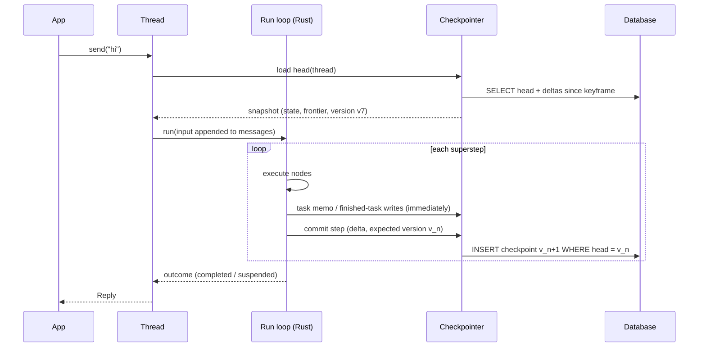

# 0008: Persistence, threads and memory

Status: **Proposed** (design phase). Builds on [0005](0005-core-runtime-extensions.md)
§5 (snapshots, saved task writes, resume) and gives developers the easy
interactive API sketched in [0007](0007-public-api.md). Research input:
[langgraph](../research/langgraph.md) §5 (checkpointing), §6 (interrupts) and §8 (store).

## Goals

1. **One parameter turns it on.** `storage="sqlite:///agent.db"` gives
   conversations, crash recovery, approval/resume, history and long-term memory.
   No extra setup code.
2. **Interactive by default.** Chatting, approving, rewinding and inspecting are
   short method calls on a `Thread` object.
3. **Same data from Python and TypeScript.** Everything stored is plain JSON
   (0005 §5.2). A thread started in Python can be continued in TypeScript.
4. **Cheap at scale.** Storage grows with *new* data, not with history length.
   LangGraph rewrites a whole changed channel each step, which is O(n²) for long
   chats ([research](../research/langgraph.md) §5.2, §10).
5. **Correct under crashes and concurrency.** Clear guarantees, documented
   limits, no silent forks.

---

## 1. Concepts

| Concept | What it is | Lifetime |
|---|---|---|
| **Thread** | One conversation or work item: a sequence of runs sharing state | Until deleted or expired |
| **Checkpoint** | Durable record of a committed step (0005 §5) | Per retention policy |
| **Short-term memory** | The thread's state, including `messages` | Lives in checkpoints |
| **Long-term memory** | Facts that outlive a thread (user preferences, learned info), in a namespaced **memory store** | Until deleted or its TTL ends |
| **Storage** | One object holding a checkpointer and a memory store, usually the same database | App lifetime |

## 2. The developer API

### 2.1 Turning it on

```python
agent = Agent(model=…, tools=[…], storage="sqlite:///agent.db")       # file, zero setup
agent = Agent(model=…, tools=[…], storage="postgres://user@host/db")  # production
agent = Agent(model=…, tools=[…])                                      # in-memory (lost on exit)
```

```ts
const agent = new Agent({ model, tools, storage: "sqlite://./agent.db" });
```

Workflows take the same parameter: `wf.compile(storage=...)`. Tables are
created automatically on first use (§6.4).

### 2.2 Threads: the interactive surface

```python
chat = agent.thread("user-42")                 # created on first use

reply = await chat.send("My order A-1001 arrived broken")
print(reply.text)

reply = await chat.send("Can you refund it?")  # remembers the conversation
if reply.needs_approval:                       # human-in-the-loop (0004 §7)
    for req in reply.approvals:
        print(req.tool, req.args, req.description)
    reply = await chat.approve()               # approve all pending
    # or: await chat.reject("Too expensive"), chat.edit(req.id, args={...}),
    #     chat.respond(req.id, "Customer already refunded")

async for event in chat.stream("Anything else?"):     # streaming send
    if event.type == "message_delta":
        print(event.text, end="")
```

| Method | Does |
|---|---|
| `send(input)` / `stream(input)` | Run one turn on the thread; returns `Reply` / streams events |
| `approve()`, `reject(msg?)`, `edit(id, args)`, `respond(id, msg)` | Answer pending approvals, then continue automatically |
| `resume(values)` | Generic resume for custom `Suspend` payloads (workflows) |
| `cancel()` | Cancel the active run on this thread |
| `state()` | Current state (messages, output, custom keys) |
| `history(limit=)` | Checkpoints, newest first: step, time, source, summary |
| `rewind(checkpoint_id)` | Make an older checkpoint the head (keeps the newer branch, §5.3) |
| `fork(checkpoint_id, new_thread=)` | Copy history up to a checkpoint into a new thread |
| `update(values)` | Edit state by hand (recorded as a `manual` checkpoint, §5.4) |
| `delete()` | Delete the thread and its checkpoints |

`Reply` fields: `text`, `output`, `status` (`completed` | `suspended`),
`needs_approval`, `approvals`, `usage`, `stop_reason`, `checkpoint_id`.

The same methods exist in TypeScript (`chat.send`, `chat.approve`, …), with
`AbortSignal` support on `send` and `stream`.

**Pending approvals survive restarts.** A process can die after `send` returns
`needs_approval`. Another process calls `agent.thread("user-42").approve()`
and continues from the stored snapshot.

### 2.3 Long-term memory

```python
from agentbuild import Memory

agent = Agent(
    model=…, tools=[…], storage="postgres://…",
    memory=Memory(
        namespace=lambda ctx: ("users", ctx.context.user_id),   # per-user memory
        recall=5,                     # inject up to 5 relevant memories before each model call
        tools=True,                   # give the model `remember` / `forget` tools
        embed="openai:text-embedding-…",   # optional: semantic search; else keyword
    ),
)
```

Direct access from app code, tools and hooks:

```python
mem = agent.storage.memory
await mem.put(("users", "42"), "diet", {"value": "vegetarian"}, ttl="90d")
item = await mem.get(("users", "42"), "diet")
hits = await mem.search(("users", "42"), query="food preferences", limit=5)
await mem.delete(("users", "42"), "diet")
```

Inside a tool: `ctx.memory` (same API, already scoped to the agent's namespace).

---

## 3. How it fits the runtime



## 4. Storage format

### 4.1 Delta checkpoints with keyframes

Each committed step stores **only what changed**, as reducer operations
(0005 §3): "append these 2 messages", "set `category`". Reducers are
deterministic and run in Rust, so replaying deltas rebuilds the state exactly.

- A **keyframe** (full state) is written every N checkpoints (default 25), and
  whenever the delta chain since the last keyframe exceeds the state's size.
- Loading a thread = the latest keyframe + the deltas after it. That's a
  bounded amount of work.
- A 500-turn chat stores each message **once**, plus occasional keyframes. Not
  500 copies of a growing list.

### 4.2 Tables (SQL backends)

```
threads(thread_id PK, created_at, updated_at, head_checkpoint_id, head_version,
        metadata JSON, expires_at)
checkpoints(checkpoint_id PK (UUIDv7), thread_id, parent_id, version, step,
        source ENUM(input, step, suspend, failure, manual, fork),
        kind ENUM(delta, keyframe), body JSON (delta ops or full snapshot),
        frontier JSON, join_progress JSON, suspended JSON, workflow_fingerprint,
        created_at)
pending_writes(checkpoint_id, task_id, key, value JSON, created_at)   -- task memo + finished-task output
memory(namespace TEXT, key TEXT, value JSON, created_at, updated_at, expires_at,
        embedding VECTOR NULL, PRIMARY KEY(namespace, key))
schema_migrations(version, applied_at)
```

Namespaces are stored as a joined path (`users/42`) so prefix search is an
index range scan. JSON is the only value format: **no pickle**, no
language-specific class names (LangGraph's msgpack embeds Python class paths,
[research](../research/langgraph.md) §5.6).

### 4.3 Backends

| Backend | URL | Use | Vector search |
|---|---|---|---|
| In-memory | (default) | Tests, scripts | brute force |
| SQLite | `sqlite:///path.db` | Local apps, single process, edge | `sqlite-vec` (optional feature) |
| Postgres | `postgres://…` | Production, multi-process | `pgvector` (optional feature) |
| Custom | `Storage(checkpointer=…, memory=…)` | Anything else | implementer's choice |

All built-in backends are implemented **once in Rust** (async, `sqlx`), so
Python and TypeScript share the same code, behaviour and on-disk format. Custom
backends implement two small interfaces (§7), in Rust or in the SDK language.
Redis/Valkey and DynamoDB are later candidates, driven by demand.

---

## 5. Guarantees and semantics

### 5.1 Durability modes

| Mode | Behaviour | Default for |
|---|---|---|
| `step` | Each step's checkpoint is written **before** the next step starts | **default** |
| `async` | Checkpoint writes overlap the next step; a crash may lose the last step (the run resumes from the previous one) | high-throughput workflows |
| `exit` | Only the final, suspended or failed state is written | short runs where only results matter |

Task memo writes (finished tool calls, 0005 §1) are always written immediately
in `step` mode. That is what lets a resumed run skip tools that already ran.

### 5.2 Concurrency on a thread

Each thread has a **head version**. A commit succeeds only if the head is still
the version the run started from (compare-and-set). A second run on a busy
thread therefore cannot silently fork it:

| `on_busy` | Second `send` while a run is active |
|---|---|
| `"wait"` (default) | Waits for the active run to finish, then runs (queued, FIFO). Waits at most `busy_timeout` (default 60 s), then `ThreadBusyError` |
| `"reject"` | Fails fast with `ThreadBusyError` (`thread_busy`) |
| `"interrupt"` | Cancels the active run (outcome `cancelled`), then runs |

Across processes, the same compare-and-set keeps it correct. `wait` uses an
advisory lock on Postgres, an in-process queue plus head-version polling with
backoff on SQLite, and a plain queue in memory. Queuing is the default because
chat UIs expect a second message to wait its turn, not to fail.

### 5.3 History, rewind and fork

- Checkpoints form a tree via `parent_id`. `rewind(id)` moves the thread head
  to an older checkpoint with source `fork`. The abandoned branch stays in
  `history(all_branches=True)` until pruned.
- Resuming from an old checkpoint **re-runs** the next steps; it does not replay
  recorded results. Use it to retry with a different input or after editing
  state. (LangGraph behaves the same, [research](../research/langgraph.md) §5.5.)

### 5.4 Manual edits

`thread.update(values)` applies `values` through the normal reducers and writes
a `manual` checkpoint. The frontier is left unchanged. A pending approval stays
pending, and the next `send` or `resume` sees the edited state. This
replaces LangGraph's `as_node` mechanism, which re-runs a node's writers and has
special `INPUT`/`END`/`__copy__` cases ([research](../research/langgraph.md) §5.5).

### 5.5 Crash recovery

On restart, a thread whose head checkpoint has a non-empty frontier and no
outcome was interrupted mid-run. `thread.recover()` (or `send`, which checks
first) re-runs the interrupted step: finished tasks reuse their saved output,
unfinished ones run again with their memo.

**Honest limit.** If the process dies *after* a tool's side effect but
*before* its memo is written, the tool runs again on recovery. For tools where
that matters, `ctx.idempotency_key` gives a deterministic key
(hash of run, step, task and `call_id`) to pass to external APIs that support
idempotency keys (payments, email providers), or to check in your own database.

---

## 6. Operations

### 6.1 Retention

`storage.retention(keep_checkpoints=50, keep_branches=False, thread_ttl="30d")`
prunes old checkpoints, never deleting the latest keyframe chain. Expired
threads and memory items are removed by a background sweep, or by calling
`storage.prune()` (for serverless deployments).

### 6.2 Privacy

- `thread.delete()` and `memory.delete_namespace(ns)` remove all rows for the
  thread or namespace, including pending writes and embeddings.
- **Run context is never stored.** `context=` holds runtime dependencies (DB
  clients, credentials) and is not part of state.
- Optional encryption at rest:
  `Storage(…, encrypt=Key.from_env("AGENTBUILD_KEY"))` encrypts `body`,
  `value` and pending writes (AES-GCM, key id stored per row for rotation).

### 6.3 Schema evolution

- The **workflow fingerprint** (0005 §5.2) is stored per checkpoint. Loading a
  thread whose fingerprint differs from the current agent or workflow follows
  `on_mismatch`:
  - `"error"` (default): `WorkflowMismatchError`;
  - `"migrate"`: run user-registered migration functions for state keys, then
    continue;
  - `"continue"`: accept the risk.
- Agents get a stable fingerprint: changing tools or instructions does **not**
  change it; changing the graph shape does.

### 6.4 Database migrations

Built-in backends version their tables (`schema_migrations`). The default is to
migrate automatically on first use. `storage.migrate(dry_run=True)` and the CLI
`agentbuild storage migrate` exist for teams that run migrations in CI.

---

## 7. Extension interfaces

```rust
trait Checkpointer: Send + Sync {
    async fn load(&self, thread: &ThreadId, at: Option<CheckpointId>) -> Result<Option<Snapshot>>;
    async fn commit(&self, thread: &ThreadId, expected: Version, cp: CheckpointRecord) -> Result<Version>; // CAS
    async fn put_pending(&self, cp: &CheckpointId, task: &TaskId, key: &str, value: Value) -> Result<()>;
    async fn history(&self, thread: &ThreadId, q: HistoryQuery) -> Result<Vec<CheckpointMeta>>;
    async fn delete_thread(&self, thread: &ThreadId) -> Result<()>;
}

trait MemoryStore: Send + Sync {
    async fn put(&self, ns: &Namespace, key: &str, value: Value, ttl: Option<Duration>) -> Result<()>;
    async fn get(&self, ns: &Namespace, key: &str) -> Result<Option<Item>>;
    async fn search(&self, ns_prefix: &Namespace, q: SearchQuery) -> Result<Vec<Item>>;
    async fn delete(&self, ns: &Namespace, key: &str) -> Result<()>;
}
```

Five checkpointer methods and four store methods. LangGraph's saver has
about 12 methods with sync and async twins
([research](../research/langgraph.md) §5.2). Keyframes, deltas, retention and
encryption are implemented **above** these interfaces, so a custom backend only
stores rows. Python and TS can implement the same interfaces (async methods);
the bridge adapts them.

## 8. Errors (added to 0003 §9)

| Code | Category | When |
|---|---|---|
| `thread_busy` | policy | Another run holds the thread and `on_busy="reject"`, or `busy_timeout` elapsed with `on_busy="wait"` |
| `storage_unavailable` | transient | Database connection or timeout failure; retried per policy, then fails |
| `storage_conflict` | developer | Compare-and-set lost for a reason other than `thread_busy` (e.g. external edit) |
| `checkpoint_not_found` | developer | `rewind`/`fork` to an unknown id |
| `workflow_mismatch` | developer | §6.3 |
| `storage_corrupt` | internal | A delta chain cannot be replayed (checksum mismatch) |

A storage failure **during** a run fails the step (nothing committed) and the
run reports the error with its in-memory snapshot attached, so no work is lost
even if the database was down.

## 9. Edge cases

| # | Case | Behaviour |
|---|---|---|
| P1 | Two browser tabs call `send` on the same thread | Second waits its turn (default) and then runs on the updated state; `on_busy="reject"` fails it instead |
| P2 | Process killed while waiting for approval | Nothing lost: the suspension was committed; any process can `approve()` later |
| P3 | Process killed mid-tool-call | `recover()` re-runs the step; finished calls are skipped; the in-flight call runs again (§5.5 idempotency key) |
| P4 | Approve twice (double click) | The first `approve()` consumes the suspension; the second gets `ResumeError` ("nothing pending") |
| P5 | Database down at `send` | `storage_unavailable` before any model call (no cost incurred) |
| P6 | Database fails at step commit | Step not committed; `RunError` carries the in-memory snapshot to retry later |
| P7 | Thread created in Python, continued in TS | Works: JSON format, same fingerprint rules |
| P8 | 10,000-message thread | Load = keyframe + ≤ 25 deltas; per-step writes stay proportional to new messages |
| P9 | Agent deployed with a new tool while threads are suspended | Fingerprint unchanged (tools excluded); pending calls are re-validated against current tools on resume (0004 A9) |
| P10 | Memory search with no embedding model configured | Keyword search (SQLite FTS5 / Postgres full-text); `warning` once |
| P11 | `memory` item too large (> 1 MB default) | `invalid_value`; long content belongs in files or blobs, not memory |
| P12 | Clock skew between processes | Ordering uses UUIDv7 plus versions, never wall-clock comparisons |

## 10. Implementation order

1. In-memory checkpointer + `Thread` API (`send`, `approve`, `history`) on top
   of 0005 snapshots.
2. SQLite backend (delta + keyframe format, compare-and-set, migrations).
3. Memory store (keyword search) + agent `Memory` hook and tools.
4. Postgres backend, `on_busy="wait"` across processes.
5. Vector search (`sqlite-vec`, `pgvector`), retention, encryption.
