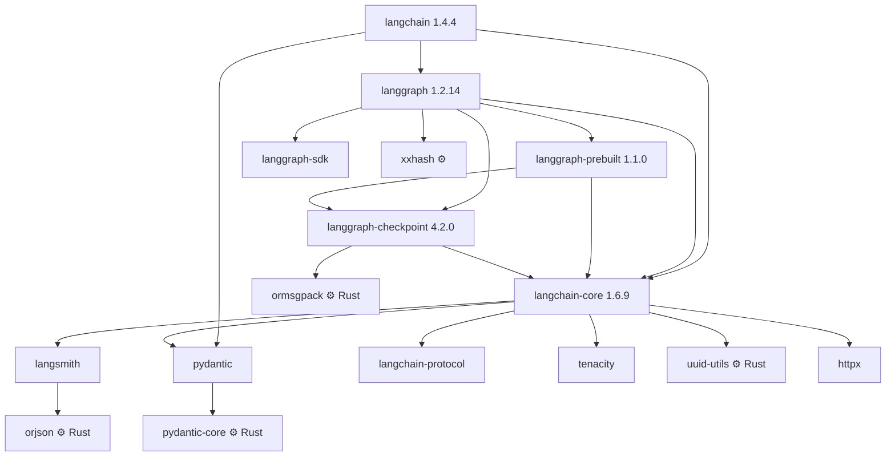

# Research: how LangChain and LangGraph are built and shipped (REA analysis)

Status: research note. Method: the REA reverse-engineering CLI (`rea-agents`
6.4.0), run against the **published wheels** downloaded from PyPI and against the
installed environment. Raw REA evidence JSON is in `research/rea-evidence/`
(git-ignored; regenerate with the commands below).

## Setup used

REA needs Node ≥22.19. The machine's system Node is 22.14, so a portable,
SHA-256-verified Node 24.21.0 lives in `research/tools/` and is used only for
REA. The system Node is untouched.

```sh
export PATH="$PWD/research/tools/node-v24.21.0-win-x64:$PATH"
R=research/tools/rea/node_modules/.bin/rea
$R inspect-artifact <wheel-or-binary> --format json
$R inspect-managed-artifact <binary> --format json
```

## 1. The five packages (REA `inspect-artifact` on each wheel)

| Wheel | Files | Uncompressed | `.py` | Native / executable | Integrity |
|---|---|---|---|---|---|
| langchain 1.4.4 | 45 | 644 KB | 40 | 0 | all 45 verified against RECORD |
| langchain-core 1.6.9 | 187 | 2.45 MB | 182 | 0 | all verified |
| langgraph 1.2.14 | 84 | 1.06 MB | 79 | 0 | all verified |
| langgraph-checkpoint 4.2.0 | 27 | 214 KB | 17 | 0 | all verified |
| langgraph-prebuilt 1.1.0 | 12 | 149 KB | 7 | 0 | all verified |

- Every wheel is tagged `py3-none-any`: pure Python, runs on any platform.
- Every wheel is built with **hatchling** (1.29–1.32).
- REA found no hidden containers, no executables, no encrypted entries and no
  integrity contradictions. It produced **no hypotheses or next probes**,
  because there is no compiled code to decompile.

**Conclusion:** the Python source *is* the implementation. Reading it, as done
in [langgraph.md](langgraph.md), [langchain-core.md](langchain-core.md) and
[langchain-agents.md](langchain-agents.md), is complete and exact. No
decompilation was needed.

## 2. Dependency graph (from wheel METADATA)



⚙ = ships compiled code.

Observations:
- **Version lock-step:** langchain pins `langgraph<1.3`, and langgraph pins
  `langgraph-prebuilt<1.2`. Separately shipped packages have to move together.
- **langsmith (a vendor tracing client) is a hard dependency of
  langchain-core.** This matches the coupling found in the source study.

## 3. Where the native code is

Compiled extension modules found in the installed environment:

| Module | Size | Built by | Role in the stack |
|---|---|---|---|
| pydantic-core | 5.5 MB | **maturin** (Rust) | All schema validation: tool args, messages, state |
| orjson | 223 KB | **maturin** (Rust) | JSON serialization (via langsmith) |
| ormsgpack | 209 KB | **maturin** (Rust) | Checkpoint serialization |
| uuid-utils | 353 KB | **maturin** (Rust) | Run IDs (UUIDv7) |
| xxhash | 68 KB | setuptools (C) | Hashing (task ids, versions) |
| zstandard, yaml, charset-normalizer, websockets | — | setuptools (C) | Transitive utilities |

REA `inspect-managed-artifact` on `orjson.cp313-win_amd64.pyd`: an x86-64 PE32+
DLL with 5 sections and no CLI directory, so it is **native, not managed**.
REA's next step would be a native decompiler (Ghidra, IDA or Hopper), none of
which are installed. It isn't needed: these are open-source Rust crates, and
their speed is not where LangChain's overhead comes from.

## 4. What this means for Criogen

1. **The hot paths of LangChain/LangGraph are already partly Rust**: validation,
   serialization and IDs. Orchestration (the Pregel loop, channels, callbacks,
   the agent factory) is pure Python. That's where the measured overhead lives
   (2.4–8.5 ms per agent step, [langchain-agents](langchain-agents.md) §7.4).
   Criogen's differentiation must therefore be **Rust orchestration**, not
   just Rust serialization. "Rust-powered" alone is not a moat; pydantic-core
   already is.
2. **maturin + PyO3 is proven at scale** (pydantic-core, orjson) for exactly
   our Phase 2 packaging. We should copy their *distribution* practices:
   per-platform wheels, and `abi3` where possible so one wheel covers many
   Python versions. Benchmark first.
3. **Ship one package, not five in lock-step.** One `criogen` wheel (Rust
   core plus the Python SDK) per platform, with providers as optional extras.
   This avoids the coordinated version pinning seen above.
4. **No hard dependency on a vendor tracer.** Tracing goes through our event
   stream (0005 §6) and optional exporters.
